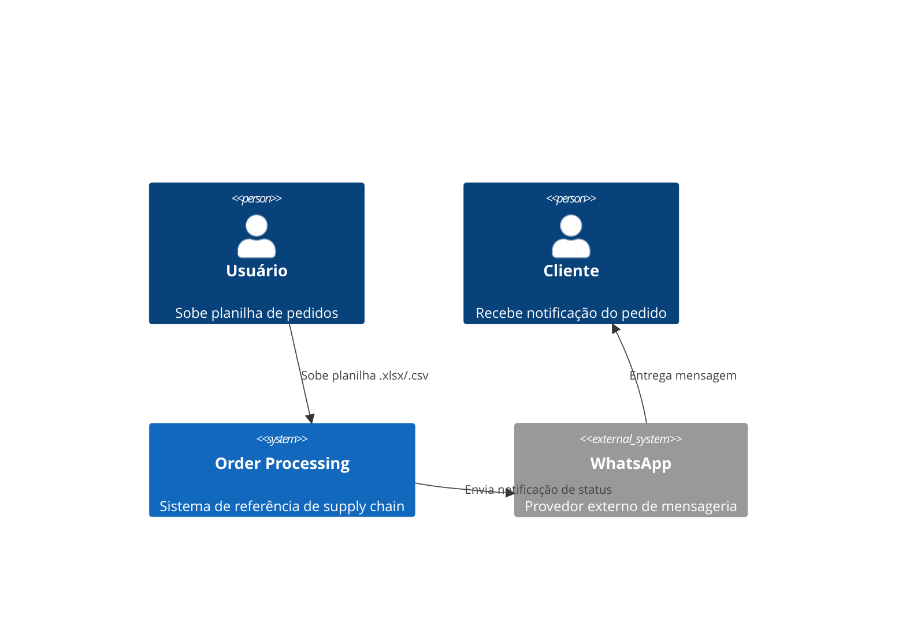
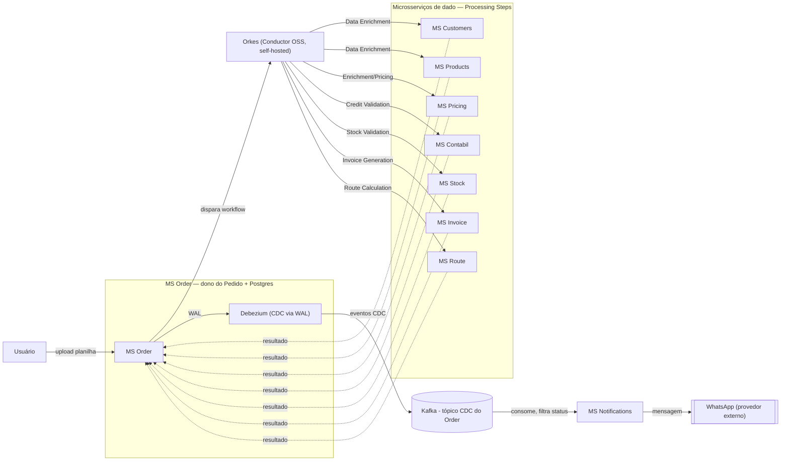

# PRD: Order Processing — sistema de referência (supply chain + guardrails de qualidade)

**Status:** Draft
**Author:** george@bonespirito.com (via Claude Code, sessão de grilling)
**Date:** 2026-08-27
**Version:** 1.0

---

## 1. Executive Summary

### Problem statement
- Faltava um projeto de referência real que provasse, em código, os guardrails de qualidade determinísticos discutidos em "Uncle Bob on Software Fundamentals in the Age of AI" (CRAP score/coverage+complexidade, mutation testing, architecture checker, MockK, Gherkin, QA E2E) — ver `doc/transcripts/ferramentas-qualidade-codigo.md`.
- Paralelamente, existia a necessidade de aprender/testar na prática: virtual threads (Java), concorrência de escrita no Postgres (`SKIP LOCKED` vs. optimistic locking — havia confusão real sobre qual resolve qual problema), CDC via Debezium, e Kafka. Hoje a concorrência de escrita em registros compartilhados é resolvida via lock distribuído no Redis.

### Proposed solution
- Um sistema de referência de supply chain — **Order Processing** — com 9 microsserviços orquestrados pelo Orkes (Conductor OSS, self-hosted), cada um demonstrando um guardrail e/ou um conceito de concorrência/streaming diferente, começando pelo MS Order (o mais crítico e mais desenhado até agora).
- Sucesso = cada MS implementado nasce com o pipeline de guardrails rodando (`./gradlew check` verde) e os cenários Gherkin do domínio passando; a concorrência real do Order (`SKIP LOCKED` + optimistic locking) é demonstrável e testável, sem depender de Redis.

### Scope
- **In scope:** MS Order (import em massa, Processing Steps, concorrência, CDC), MS Notifications (WhatsApp em mudança de status), design dos demais 7 MS de dado (Customers, Products, Pricing, Stock, Contabil, Invoice, Route) como dependências de API — implementação deles é incremental, fora deste PRD.
- **Out of scope (por ora):** implementação de código de qualquer serviço (esta rodada foi só design — ver Decisão de escopo abaixo); escolha de provedor real de WhatsApp; cálculo real de rota (MS Route é só contrato, sem lógica de roteirização definida); fórmula composta de CRAP score (fica JaCoCo+Detekt como proxy, ver `ferramentas-qualidade-codigo.md`).

---

## 2. Functional Requirements

| ID | Requirement | Priority | Acceptance Criteria |
|---|---|---|---|
| FR-01 | Usuário importa pedidos em massa via planilha (.xlsx/.csv) | P0 | Upload cria 1 Order por linha válida, status `PENDING`; linhas inválidas são reportadas sem bloquear as válidas — ver `bulk_import.feature` |
| FR-02 | Order passa por Processing Steps concorrentes (Enrichment, Credit Validation, Stock Validation, Route Calculation, Invoice Generation) sem lost update | P0 | Duas etapas concorrentes no mesmo Order preservam as duas escritas — ver `concurrent_processing_steps.feature`, ADR 0001 |
| FR-03 | Mudanças no Order são publicadas via CDC no Kafka | P0 | Debezium captura toda mudança em `orders` via WAL, publica no tópico Kafka — ADR 0002 |
| FR-04 | Cliente recebe WhatsApp a cada mudança de status do Order | P1 | Mudança de `status` dispara mensagem; mudança em outro campo não dispara — ver `status_change_notification.feature`, ADR notifications/0001 |
| FR-05 | Workflow de processamento é orquestrado pelo Orkes, self-hosted | P0 | Conductor OSS roda via `docker compose`, sem dependência de conta externa (Orkes Cloud) |

**Priority legend:** P0 = MVP (must have), P1 = Next iteration (should have)

### User stories
```
Como usuário do sistema,
Quero importar vários pedidos de uma vez via planilha,
Para não cadastrar cada um manualmente.

Como sistema,
Quero aplicar o resultado de Processing Steps concorrentes sem perder escrita,
Para que o Order reflita corretamente o trabalho de todas as etapas.

Como cliente que fez um pedido,
Quero ser avisado via WhatsApp a cada mudança de status,
Para acompanhar o andamento sem consultar o sistema.
```

- US-01 → FR-01
- US-02 → FR-02, FR-03
- US-03 → FR-04

---

## 3. Definitions of Ready (DoR)

| # | Criterion | Status |
|---|---|---|
| 1 | Acceptance criteria definidos (Gherkin) | ✅ `bulk_import.feature`, `concurrent_processing_steps.feature`, `status_change_notification.feature` |
| 2 | Dependências identificadas | ✅ Postgres, Kafka, Debezium, Orkes/Conductor OSS, provedor WhatsApp (não escolhido) |
| 3 | Abordagem técnica validada | ✅ via sessão de grilling — ADRs 0001/0002/notifications-0001 |
| 4 | Cabe na arquitetura atual | N/A — é greenfield, arquitetura sendo definida por este PRD |
| 5 | Expectativas de performance/segurança documentadas | ⚠️ Não aprofundado — projeto de aprendizado, não produção |

Requisito NÃO atende DoR: **implementação em si** — decisão explícita da sessão foi "só desenhar por enquanto" (ver Decisão de escopo). Este PRD é o artefato de saída; a implementação é uma iteração futura.

---

## 4. Engineering Vision

### System impact
- 9 bounded contexts novos, todos greenfield: **Order** (dono do Pedido+status), **Customers**, **Products**, **Pricing**, **Stock**, **Contabil**, **Invoice**, **Route**, **Notifications**.
- Database-per-service — nenhum MS compartilha tabela com outro (ver decisão na sessão de grilling).
- Integração externa: provedor de WhatsApp Business API (não escolhido ainda — Twilio, Meta Cloud API, etc. são candidatos).
- Fluxo de dado: entrada via planilha (MS Order) → saída via Kafka (CDC) → WhatsApp (MS Notifications).

### C4 — Level 1: System Context



### C4 — Level 2: Container

Diagrama completo (9 MS + Orkes + Kafka/Debezium) em `app/docs/diagrams/order-processing-architecture.drawio.svg` (editável no draw.io). Fonte Mermaid equivalente:



### Glossário e decisões arquiteturais

- **Glossário do domínio Order:** [`app/order/CONTEXT.md`](../../order/CONTEXT.md)
- **Mapa de contextos (9 MS):** [`app/CONTEXT-MAP.md`](../../CONTEXT-MAP.md)
- **ADR 0001** — optimistic locking (version) substitui Redis lock para concorrência entre Processing Steps: [`app/order/docs/adr/0001-optimistic-locking-for-order-writes.md`](../../order/docs/adr/0001-optimistic-locking-for-order-writes.md)
- **ADR 0002** — Debezium (WAL) em vez de outbox pattern para CDC do Order: [`app/order/docs/adr/0002-debezium-for-order-cdc.md`](../../order/docs/adr/0002-debezium-for-order-cdc.md)
- **ADR notifications/0001** — MS Notifications consome o tópico CDC existente em vez de evento de domínio próprio: [`app/notifications/docs/adr/0001-consume-order-cdc-topic.md`](../../notifications/docs/adr/0001-consume-order-cdc-topic.md)

### Onde entram os conceitos que motivaram o projeto

| Conceito a aprender/testar | Onde vive no design |
|---|---|
| Virtual threads | Ingestão em massa da planilha (MS Order); pool de workers que reivindicam `order_update_event` |
| `SKIP LOCKED` | Fila interna `order_update_event` em MS Order — workers reivindicam evento pendente, não o Order em si (ADR 0001 explica por que `SKIP LOCKED` não serve pra proteger a linha do Order) |
| Optimistic locking | Coluna `version` no Order — mecanismo real que evita lost update entre Processing Steps concorrentes |
| CDC / Debezium | MS Order publica toda mudança da tabela `orders` via WAL (ADR 0002) |
| Kafka | Tópico CDC do Order — consumido por MS Notifications e por consumidores externos |

### Guardrails de qualidade (objetivo original do projeto)

Aplicados a cada MS conforme for implementado, começando por MS Order — mapeamento ferramenta do vídeo → ferramenta Kotlin/Gradle já validado antes desta sessão de grilling:

| Ferramenta do vídeo | Implementação | Gate |
|---|---|---|
| CRAP score (proxy) | JaCoCo (coverage) + Detekt (complexidade, threshold humano=8/agente=12) | `./gradlew check` |
| Mutation testing | Pitest, `targetClasses=domain.*` | `./gradlew pitest` (separado, mais caro) |
| Architecture checker | ArchUnit — camadas controller/application/domain/infra | `./gradlew check` |
| MockK | Testes de `application`, substitui Mockito | `./gradlew check` |
| Gherkin | Cucumber-JVM — `bulk_import.feature`, `concurrent_processing_steps.feature`, `status_change_notification.feature` | `./gradlew check` |
| QA procedure / E2E | Playwright contra HTTP real | `docker compose run --rm e2e pnpm test:e2e` (separado) |

### Key technical constraints
- Container-first obrigatório (golden rule) — todo MS com `Dockerfile` + serviço na `compose.yaml`, nada roda no host.
- Kotlin + Spring Boot, Gradle Kotlin DSL + version catalog — sem exceção, por MS.
- Performance/disponibilidade/segurança: **não aprofundado** — projeto de aprendizado, não é para produção real; se algum dia for, revisitar antes.

### Risks & unknowns

| Risk | Impact | Mitigation |
|---|---|---|
| Pitest não tem plugin Kotlin-aware maduro/gratuito | Mutantes ruidosos em `data class`/`when` exaustivo | Restringir `targetClasses` a `domain.*`, documentar falso-positivo conhecido |
| Provedor de WhatsApp não escolhido | Bloqueia implementação de MS Notifications até decidir | Definir na iteração que for implementar Notifications, não bloqueia o design dos outros MS |
| Escala do "import em massa" não quantificada | Design de parsing (streaming vs. DOM completo do .xlsx) pode ficar errado se volume for muito maior que o assumido | Perguntar volume esperado antes de detalhar o parser, quando chegar a hora de implementar |
| 9 MS é escopo grande pra uma pessoa manter | Risco de abandono/inconsistência entre serviços | Implementação incremental por fatia vertical (MS Order primeiro), não big-bang — decisão já tomada nesta sessão |
| Database-per-service + Debezium por serviço = 9x a infra de CDC se todos publicarem CDC | Complexidade operacional alta | Só MS Order tem CDC/Debezium confirmado neste PRD; os demais MS decidem sob demanda quando forem implementados |

---

## 5. Test Scenarios

Cenários Gherkin já escritos como `.feature` executável (não só tabela ilustrativa — ver nota sobre gap no `FEATURE_SPEC.md` abaixo):

| ID | Scenario | Given | When | Then | Mapped FR | Arquivo |
|---|---|---|---|---|---|---|
| TC-01 | Import válido | Planilha .csv com 3 linhas válidas | Upload na API de importação | 3 Orders criados, status `PENDING`, workflow disparado | FR-01 | `app/order/.../bulk_import.feature` |
| TC-02 | Import com linha inválida | Planilha com 1 linha sem cliente | Upload na API | 2 Orders criados; linha inválida reportada | FR-01 | `app/order/.../bulk_import.feature` |
| TC-03 | Concorrência sem lost update | Order v1, 2 etapas concorrentes | Enrichment + Credit Validation reportam ao mesmo tempo | Ambas as escritas preservadas, versão avança em 2 | FR-02 | `app/order/.../concurrent_processing_steps.feature` |
| TC-04 | Conflito de versão | Order v3, 2 escritas concorrentes na mesma versão | Escritas simultâneas | Uma aplica e avança pra v4; outra recarrega v4 e reaplica | FR-02 | `app/order/.../concurrent_processing_steps.feature` |
| TC-05 | Notificação em mudança de status | Order `PENDING`, cliente com WhatsApp | Status muda pra `PROCESSING` | Evento CDC publicado; WhatsApp enviado | FR-03, FR-04 | `app/notifications/.../status_change_notification.feature` |
| TC-06 | Sem notificação fora de status | Order `PROCESSING` | Campo não-status muda | Nenhuma mensagem enviada | FR-04 | `app/notifications/.../status_change_notification.feature` |

**Gap identificado nesta sessão:** `~/.claude/templates/FEATURE_SPEC.md` não tem elo pra traduzir a tabela Given/When/Then do PRD em `.feature` executável — esses arquivos foram criados diretamente para este projeto, fora do fluxo padrão de templates.

---

## 6. Rollout & Success

### Definition of Done (DoD) — por MS implementado
- [ ] `./gradlew check` verde (compile + testes + ArchUnit + Cucumber + Detekt + JaCoCo)
- [ ] `./gradlew integrationTest` verde (quando aplicável — repositório real)
- [ ] `./gradlew pitest` rodado, mutation score revisado (não necessariamente 100%, mas sem mutante óbvio ignorado)
- [ ] `docker compose run --rm e2e pnpm test:e2e` verde
- [ ] ADRs relevantes escritos/atualizados
- [ ] `CONTEXT.md` do contexto atualizado se linguagem nova surgiu

### Success metrics
Projeto de aprendizado — sucesso é qualitativo, não métrica de produto:
- Você consegue explicar, com o código rodando, por que `SKIP LOCKED` não resolve lost update no Order e o que resolve.
- Virtual threads demonstráveis com throughput comparável (mesmo que informalmente) contra thread pool tradicional na ingestão em massa.
- CDC via Debezium funcionando ponta a ponta, evento chegando em MS Notifications e disparando WhatsApp.

### Rollout plan
- Sem rollout de produção — decisão desta sessão foi manter em design até você decidir implementar.
- Quando for implementar: começar por **MS Order** sozinho (fatia vertical), guardrails completos nele primeiro, antes de tocar nos outros 8 MS.

---

## Histórico da sessão (rastreabilidade)

- Repositório inicializado em Codeberg (`torgge/uncle-bob-best-practices-with-ia`) via `tea` CLI, commit inicial com o conteúdo de `doc/transcripts/`.
- Domínio evoluiu de um "Task Manager" genérico (descartado) para este sistema de Order Processing, através de uma sessão de grilling completa (`/mattpocock-skills:grill-with-docs`) que corrigiu, entre outras coisas, o mal-entendido inicial sobre `SKIP LOCKED` vs. optimistic locking.
- Escopo de implementação foi explicitamente limitado a design nesta rodada — nenhum código Kotlin/Gradle foi criado, só documentação/especificação (ADRs, CONTEXT.md, Gherkin, diagrama).
