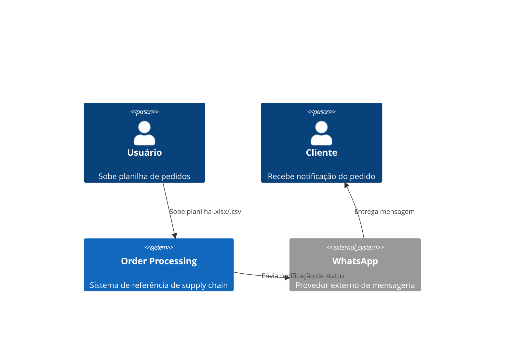
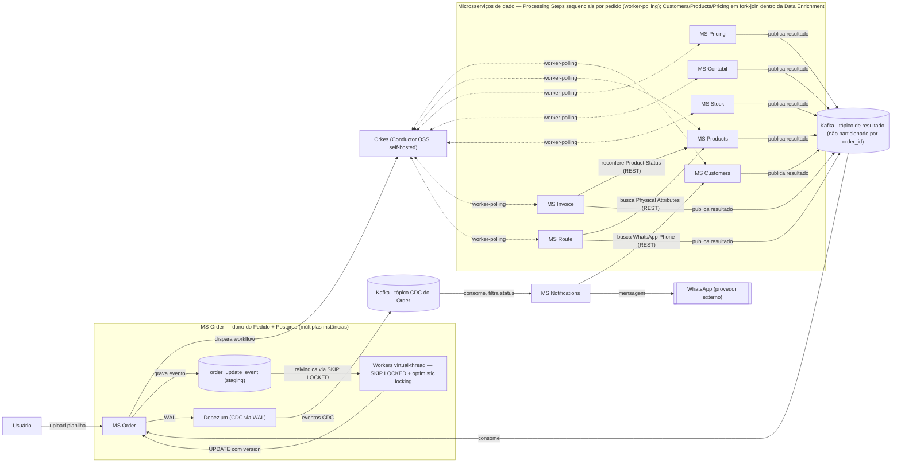
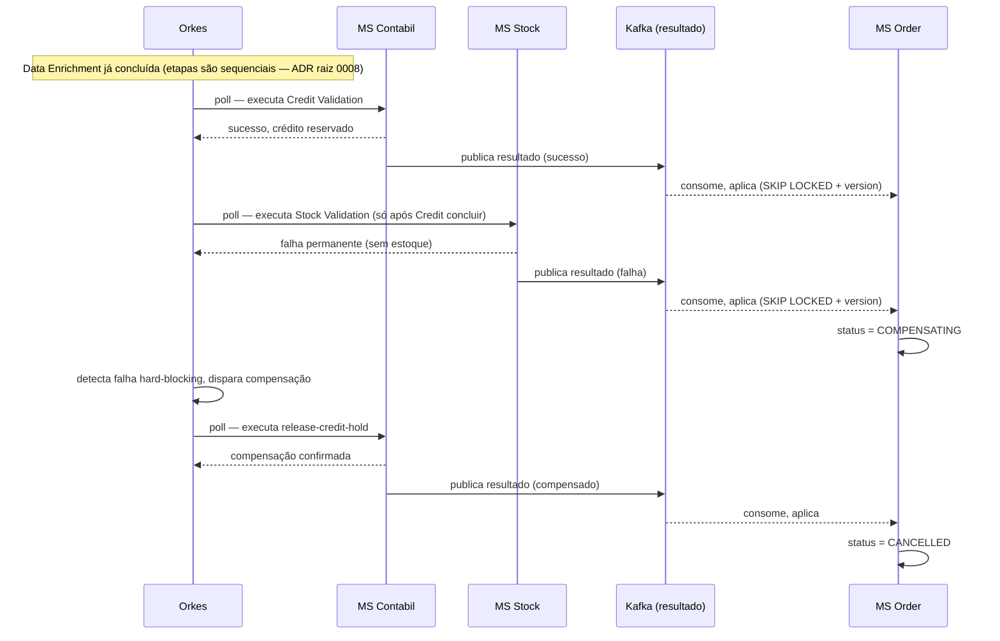

# PRD: Order Processing — sistema de referência (supply chain + guardrails de qualidade)

**Status:** Draft
**Author:** george@bonespirito.com (via Claude Code, sessão de grilling)
**Date:** 2026-08-27
**Version:** 1.0

---

## 1. Executive Summary

### Problem statement
- Faltava um projeto de referência real que provasse, em código, os guardrails de qualidade determinísticos discutidos em "Uncle Bob on Software Fundamentals in the Age of AI" (CRAP score/coverage+complexidade, mutation testing, architecture checker, MockK, Gherkin, QA E2E) — ver `doc/transcripts/ferramentas-qualidade-codigo.md`.
- Paralelamente, existia a necessidade de aprender/testar na prática: virtual threads (Java), concorrência de escrita no Postgres (`SKIP LOCKED` vs. optimistic locking — havia confusão real sobre qual resolve qual problema), CDC via Debezium, e Kafka. Hoje a concorrência de escrita em registros compartilhados é resolvida via lock distribuído no Redis.

### Proposed solution
- Um sistema de referência de supply chain — **Order Processing** — com 9 microsserviços orquestrados pelo Orkes (Conductor OSS, self-hosted), cada um demonstrando um guardrail e/ou um conceito de concorrência/streaming diferente, começando pelo MS Order (o mais crítico e mais desenhado até agora).
- Sucesso = cada MS implementado nasce com o pipeline de guardrails rodando (`./gradlew check` verde) e os cenários Gherkin do domínio passando; a concorrência real do Order (`SKIP LOCKED` + optimistic locking) é demonstrável e testável, sem depender de Redis.

### Scope
- **In scope:** MS Order (import em massa, Processing Steps, concorrência, CDC), MS Notifications (WhatsApp em mudança de status), design dos demais 7 MS de dado (Customers, Products, Pricing, Stock, Contabil, Invoice, Route) como dependências de API — implementação deles é incremental, fora deste PRD.
- **Out of scope (por ora):** implementação de código de qualquer serviço (esta rodada foi só design — ver Decisão de escopo abaixo); escolha de provedor real de WhatsApp; cálculo real de rota (MS Route é só contrato, sem lógica de roteirização definida); fórmula composta de CRAP score (fica JaCoCo+Detekt como proxy, ver `ferramentas-qualidade-codigo.md`).

---

## 2. Functional Requirements

| ID | Requirement | Priority | Acceptance Criteria |
|---|---|---|---|
| FR-01 | Usuário importa pedidos em massa via planilha (.xlsx/.csv) | P0 | Upload cria 1 Order por linha válida, status `PENDING`; linhas inválidas são reportadas sem bloquear as válidas — ver `bulk_import.feature` |
| FR-02 | Order passa pelas 5 Processing Steps em sequência (Enrichment, Credit Validation, Stock Validation, Route Calculation, Invoice Generation), com as 3 tasks de enriquecimento concorrentes entre si e sem lost update | P0 | Duas tasks de enriquecimento concorrentes no mesmo Order preservam as duas escritas — ver `concurrent_processing_steps.feature`, ADR raiz 0008, ADR order/0001 |
| FR-03 | Mudanças no Order são publicadas via CDC no Kafka | P0 | Debezium captura toda mudança em `orders` via WAL, publica no tópico Kafka — ADR 0002 |
| FR-04 | Cliente recebe WhatsApp a cada mudança de status do Order | P1 | Só evento CDC com `op=u` **e** `before.status != after.status` dispara mensagem; snapshot (`op=r`) e insert (`op=c`) nunca disparam — ver `status_change_notification.feature`, ADR notifications/0001 |
| FR-05 | Workflow de processamento é orquestrado pelo Conductor, self-hosted | P0 | `conductor-oss/conductor` (fork mantido pela Orkes desde que a Netflix arquivou o projeto em 2023), sem dependência de conta externa (Orkes Cloud). Deploy no cluster K3s via ArgoCD (ADR raiz 0006) — **ainda não existe no cluster**, levantamento de custo em andamento com a sessão de infra |
| FR-06 | Falha permanente numa Processing Step hard-blocking cancela o Order e compensa efeito colateral já aplicado | P0 | Stock Validation/Credit Validation já bem-sucedidas são revertidas na própria base do MS dono; Order vai a `CANCELLED` — ver `compensating_flow.feature`, ADR raiz 0002 |

**Priority legend:** P0 = MVP (must have), P1 = Next iteration (should have)

### User stories
```
Como usuário do sistema,
Quero importar vários pedidos de uma vez via planilha,
Para não cadastrar cada um manualmente.

Como sistema,
Quero aplicar o resultado das tasks concorrentes de enriquecimento sem perder escrita,
Para que o Order reflita corretamente o trabalho de todas as etapas.

Como cliente que fez um pedido,
Quero ser avisado via WhatsApp a cada mudança de status,
Para acompanhar o andamento sem consultar o sistema.

Como sistema,
Quero desfazer efeito colateral já aplicado quando uma etapa posterior falha,
Para não deixar estoque ou crédito reservados num pedido cancelado.
```

- US-01 → FR-01
- US-02 → FR-02, FR-03
- US-03 → FR-04
- US-04 → FR-06

---

## 3. Definitions of Ready (DoR)

| # | Criterion | Status |
|---|---|---|
| 1 | Acceptance criteria definidos (Gherkin) | ✅ `bulk_import.feature`, `concurrent_processing_steps.feature`, `status_change_notification.feature`, `compensating_flow.feature`, `awaiting_master_data.feature`, `partial_fulfillment.feature`, `order_value.feature`, `stock_reservation.feature`, `credit_hold.feature`, `invoice_generation.feature`, `route_calculation.feature`, `status_change_notification.feature` |
| 2 | Dependências identificadas | ✅ Postgres (schema via **Flyway**), Kafka, Debezium, Conductor OSS (`conductor-oss/conductor`), Apicurio, OpenTelemetry, Meta Cloud API |
| 3 | Abordagem técnica validada | ✅ via sessão de grilling — ADRs raiz 0001/0002/0008, order 0001/0002/0003/0011/0012/0013/0014/0015/0016/0017/0018, notifications 0001/0003/0004 |
| 4 | Cabe na arquitetura atual | N/A — é greenfield, arquitetura sendo definida por este PRD |
| 5 | Expectativas de performance/segurança documentadas | ⚠️ Não aprofundado — projeto de aprendizado, não produção |

Requisito NÃO atende DoR: **implementação em si** — decisão explícita da sessão foi "só desenhar por enquanto" (ver Decisão de escopo). Este PRD é o artefato de saída; a implementação é uma iteração futura.

---

## 4. Engineering Vision

### System impact
- 9 bounded contexts novos, todos greenfield: **Order** (dono do Pedido+status), **Customers**, **Products**, **Pricing**, **Stock**, **Contabil**, **Invoice**, **Route**, **Notifications**.
- Database-per-service — nenhum MS compartilha tabela com outro (ver decisão na sessão de grilling).
- Integração externa: provedor de WhatsApp Business API (não escolhido ainda — Twilio, Meta Cloud API, etc. são candidatos).
- Fluxo de dado: entrada via planilha (MS Order) → saída via Kafka (CDC) → WhatsApp (MS Notifications).
- Observabilidade: **OpenTelemetry** — o MS Order nasce instrumentado (confirmado 2026-09-03 com a sessão de infra). No cluster, OTel Collector como transporte e Grafana Tempo como backend, reusando o Grafana já existente; SigNoz e Jaeger descartados pelo lado da infra. Alertas genéricos (crash loop, Application degradada) são herdados automaticamente do Alertmanager do cluster; métricas de domínio dependem do que a aplicação expuser.

### C4 — Level 1: System Context

Diagrama editável: [`app/docs/diagrams/c4-l1-system-context.drawio.svg`](../diagrams/c4-l1-system-context.drawio.svg). Tudo decidido nesta altitude — sem elemento indefinido.



### C4 — Level 2: Container

Diagrama editável: [`app/docs/diagrams/c4-l2-containers.drawio.svg`](../diagrams/c4-l2-containers.drawio.svg) — verde sólido = decidido, cinza pontilhado = indefinido. MS Order (com Postgres/staging/workers/Debezium), Orkes, Apicurio Registry e os tópicos Kafka estão decididos; os outros 7 MS de dado, o provedor de WhatsApp e o deploy K3s estão indefinidos (gray areas #5, #6, #9). No SVG, tópicos Kafka são desenhados como **cilindro horizontal** (fila/tópico) e Postgres/staging como **cilindro vertical** (banco/tabela) — distinção que o Mermaid abaixo não consegue expressar (não tem shape de cilindro horizontal nativo), então no bloco a seguir todos aparecem como `[(...)]`; o SVG é a fonte visual correta, este Mermaid é só estrutura:



### C4 — Level 3: Component (MS Order)

Diagrama editável: [`app/docs/diagrams/c4-l3-order-components.drawio.svg`](../diagrams/c4-l3-order-components.drawio.svg). Só MS Order tem L3 — é o único container com detalhe suficiente resolvido; dos outros 8 MS, os 9 contextos têm `CONTEXT.md` (gray area #5) — mas nenhum tem detalhe interno resolvido e nenhum tem detalhe interno resolvido, então um L3 deles seria invenção, não design. Consistente com `rules/docs.md`: "C4 Level 3 gerado sob demanda quando a complexidade justifica."

Decidido (verde): Bulk Import Handler, `Order`/`OrderItem` (JPA, aggregate root), Repository, os 7 consumers Kafka, `order_update_event` (staging), worker pool `SKIP LOCKED`, apply com optimistic locking, Debezium connector, DLT Publisher. Indefinido (cinza pontilhado): contrato REST do endpoint de import (path/shape — nunca especificado), contract test de schema Avro em CI (gray area #12), classificador transitória-vs-permanente (o conceito está na ADR raiz 0005, os tipos de exceção específicos não).

### Modelo de dados: `orders` e `order_items`

Order é aggregate root; `order_items` é tabela filha (N produtos por pedido — confirmado nesta rodada de grilling, substituindo a suposição inicial de item único). Um `version` só, no Order, protege o agregado inteiro incluindo os itens (ver nota de escopo na ADR order/0001). Snapshots (`customer_snapshot`, `product_snapshot`) são colunas tipadas/`@Embedded` (Value Objects), não JSONB — consistente com Tactical DDD.

**`orders`**

| Coluna | Origem | Nullable até a etapa rodar |
|---|---|---|
| `id` | import | — (PK, é o `orderId` do Kafka) |
| `status`, `version` | sistema | — (`status`: `PENDING` \| `PROCESSING` \| `AWAITING_MASTER_DATA` \| `INVOICING` \| `COMPLETED` \| `COMPENSATING` \| `CANCELLED` \| `COMPENSATION_FAILED` — glossário em `app/order/CONTEXT.md`) |
| `customer_id` | import | — (identidade do Customer emitida pelo MS Customers, trazida pela planilha; referência sem FK real — database-per-service) |
| `source_system_code` | import | — (qual sistema de origem mandou o pedido, ex: "SAP") |
| `source_order_number` | import | — (chave natural do pedido no sistema de origem; par com `source_system_code` deve ser `UNIQUE` — usado pra idempotência do import, ver Contrato REST) |
| `order_created_at` | import | — (data de criação no sistema de origem — distinto de `created_at`, que é quando ESTE sistema processou) |
| `customer_snapshot` (`@Embedded`: nome legal, documento, endereço de entrega padrão) | Data Enrichment (Customers) | sim |
| `credit_status`, `credit_hold_id` | Credit Validation | sim (hold criado na validação, **convertido em dívida na Invoice Generation**, liberado só por compensação — [ADR order/0015](../../order/docs/adr/0015-credit-hold-lifecycle.md)) |
| `stock_reservation_id` | Stock Validation | sim (atômico sobre o conjunto de itens `FULFILLED` — ou reserva todos ou nenhum, com um id só; item `NOT_FULFILLED` não participa. Stock Validation é hard-blocking: falta de estoque cancela o Order — [ADR order/0014](../../order/docs/adr/0014-out-of-stock-cancels-order.md)) |
| `route_id`, `tracking_code`, `estimated_delivery` | Route Calculation | sim (plano congelado; `tracking_code` é dado repassado, **não** estado de entrega — [ADR order/0017](../../order/docs/adr/0017-route-is-a-plan-not-a-delivery.md)) |
| `invoice_number`, `invoice_issued_at` | Invoice Generation | sim (documento **interno**, numeração monotônica com buracos tolerados, terminal — [ADR order/0016](../../order/docs/adr/0016-invoice-is-internal-and-terminal.md)) |
| `partially_fulfilled` | Invoice Generation | sim (escrita na **mesma transação da transição terminal**; é o único dado pelo qual o Notifications sabe escolher o template variante de conclusão parcial, já que ele não consome `order_items` — [ADR notifications/0005](../../notifications/docs/adr/0005-partial-completion-template-selection.md)) |
| `import_batch_id` | import | — (rastreia a `bulk_import.feature` de origem) |
| _(sem coluna de total)_ | — | Order Total é **derivado** da soma dos itens `FULFILLED`, nunca armazenado — ver [ADR order/0013](../../order/docs/adr/0013-order-total-derived-and-price-frozen-at-enrichment.md) |
| `created_at`, `updated_at` | sistema | — |

**`order_items`**

| Coluna | Origem | Nullable até a etapa rodar |
|---|---|---|
| `id` | import | — (PK) |
| `order_id` | import | — (FK, não é aggregate próprio — ver termo Order Item no CONTEXT.md) |
| `sku`, `quantity` | import | — |
| `product_snapshot` (`@Embedded`: name, categoria) | Data Enrichment (Products) | sim |
| `unit_price`, `currency` | Data Enrichment (Pricing) | sim — Snapshot do preço no momento do enriquecimento, nunca reconferido; moeda única no sistema ([ADR order/0013](../../order/docs/adr/0013-order-total-derived-and-price-frozen-at-enrichment.md)) |
| `fulfillment_status` (`FULFILLED`/`NOT_FULFILLED`), `not_fulfilled_reason` | Data Enrichment (Products) | sim — só decidido quando a Product Enrichment roda; ver [ADR order/0012](../../order/docs/adr/0012-partial-fulfillment-for-inactive-products.md) |

**`import_batches`** (ADR order/0004 — existe antes de qualquer `Order`, por isso não é campo em `orders`)

| Coluna | Descrição |
|---|---|
| `id` | PK, é o `importBatchId` do contrato REST |
| `file_fingerprint` | hash do conteúdo do arquivo, `UNIQUE` — reenvio do mesmo arquivo é recusado no upload (`409`), sem criar batch |
| `status` | `PENDING` \| `PROCESSING` \| `COMPLETED` \| `COMPLETED_WITH_ERRORS` |
| `total_rows`, `processed_rows`, `orders_created` | contadores, atualizados durante o processamento |
| `file_name` | rastreabilidade |
| `created_at`, `completed_at` | `completed_at` nullable até terminar |

**`import_batch_row_errors`**

| Coluna | Descrição |
|---|---|
| `id` | PK |
| `import_batch_id` | FK |
| `row_number` | linha da planilha onde o erro ocorreu |
| `reason` | motivo (dado ausente, duplicata de `source_order_number`, etc.) |

### Contrato REST: bulk import (ADR order/0004)

Planilha denormalizada: cabeçalho (`source_system_code`, `source_order_number`, `customer_id`, `order_created_at`) repetido em toda linha de item (`sku`, `quantity`). Até ~50.000 linhas por arquivo. O `customer_id` é a identidade emitida pelo MS Customers — o sistema de origem precisa conhecê-la; não existe código alternativo por sistema de origem nem etapa de conversão (ver [Customers CONTEXT.md](../../customers/CONTEXT.md)).

**`POST /imports/orders`** — multipart, campo `file` (.xlsx ou .csv)
→ `202 Accepted`
```json
{ "importBatchId": "uuid", "status": "PENDING" }
```
→ `409 Conflict` — arquivo com o mesmo Import Fingerprint já foi importado; devolve o `importBatchId` do lote original e nenhum batch novo é criado.

**`GET /imports/orders/{importBatchId}`**
→ `200 OK`
```json
{
  "importBatchId": "uuid",
  "status": "PENDING | PROCESSING | COMPLETED | COMPLETED_WITH_ERRORS",
  "totalRows": 50000,
  "processedRows": 50000,
  "ordersCreated": 12000,
  "rowErrorCount": 3
}
```
Erros de linha não vêm inline (lote ruim pode ter milhares) — ficam em `import_batch_row_errors`; endpoint de listagem paginada dos erros fica como detalhe de implementação, não desenhado nesta rodada.

Duplicata de `(source_system_code, source_order_number)` — dentro do mesmo lote ou contra lote anterior — vira `import_batch_row_errors`, não bloqueia o resto. São duas camadas distintas de idempotência: o Import Fingerprint pega o reenvio do arquivo inteiro, o par acima pega o pedido repetido entre arquivos diferentes.

**Topologia Kafka (acordada com a sessão de infra, 2026-09-03):** 7 tópicos de resultado com **3 partições** cada — o paralelismo entre instâncias de MS Order depende disso (ADR order/0003); 7 tópicos `.dlt` e o tópico CDC com **1 partição** (baixo volume, resolução manual). Replication factor `1` em todos, imposto por haver um único broker. Tópicos criados declarativamente pela infra, sem depender de auto-create.

**Nome do tópico CDC:** o conector Debezium usa `topic.prefix = order.cdc`, o que produz o tópico **`order.cdc.public.orders`** (o Debezium compõe `<topic.prefix>.<schema>.<tabela>`). Pontos como separador mantêm consistência com os tópicos de resultado (`order.customer-enrichment.result`). É o tópico que o MS Notifications consome — ADR notifications/0001.

**Ingress:** `ms-order.lab.bonespirito.com` (padrão da ADR-005 do repo de infra). Traefik 3.7.8 não limita tamanho de body por padrão e não há middleware de buffering, então o upload da planilha passa sem ajuste — verificado pela sessão de infra.

**O import não valida cliente nem produto contra outro microsserviço.** Só o que dá pra verificar dentro do próprio arquivo produz erro de linha. Existência de `customer_id` e de `sku` é verificada de forma assíncrona, pelas Processing Steps de Data Enrichment; cadastro faltando trava a task no Orkes até o dado existir, em vez de recusar a linha — ver [ADR order/0011](../../order/docs/adr/0011-async-only-enrichment-await-master-data.md).

### Diagrama de sequência: fluxo compensatório

Order com Credit Validation já bem-sucedida (crédito reservado) e Stock Validation falhando permanentemente por falta de estoque:



### Glossário e decisões arquiteturais

- **Glossário do domínio Order:** [`app/order/CONTEXT.md`](../../order/CONTEXT.md)
- **Glossário do domínio Customers:** [`app/customers/CONTEXT.md`](../../customers/CONTEXT.md)
- **Glossário do domínio Products:** [`app/products/CONTEXT.md`](../../products/CONTEXT.md)
- **Glossário do domínio Pricing:** [`app/pricing/CONTEXT.md`](../../pricing/CONTEXT.md)
- **Glossário do domínio Stock:** [`app/stock/CONTEXT.md`](../../stock/CONTEXT.md)
- **Glossário do domínio Contabil:** [`app/contabil/CONTEXT.md`](../../contabil/CONTEXT.md)
- **Glossário do domínio Invoice:** [`app/invoice/CONTEXT.md`](../../invoice/CONTEXT.md)
- **Glossário do domínio Route:** [`app/route/CONTEXT.md`](../../route/CONTEXT.md)
- **Glossário do domínio Notifications:** [`app/notifications/CONTEXT.md`](../../notifications/CONTEXT.md)
- **Mapa de contextos (9 MS):** [`app/CONTEXT-MAP.md`](../../CONTEXT-MAP.md)
- **ADR raiz 0001** — worker-polling entre Orkes e os 7 MS de dado, em vez de HTTP push: [`app/docs/adr/0001-worker-polling-for-processing-steps.md`](../adr/0001-worker-polling-for-processing-steps.md)
- **ADR raiz 0002** — fluxo compensatório (Saga): quais steps compensam, ordem do workflow, estado `COMPENSATION_FAILED`: [`app/docs/adr/0002-compensating-flow-for-order-processing.md`](../adr/0002-compensating-flow-for-order-processing.md)
- **ADR raiz 0003** — Avro + Apicurio Registry para as mensagens Kafka (resultado das steps e CDC): [`app/docs/adr/0003-avro-schema-registry-for-kafka-messages.md`](../adr/0003-avro-schema-registry-for-kafka-messages.md)
- **ADR raiz 0004** — um tópico Kafka por task do Conductor (7, não 1), Data Enrichment é sub-workflow de 3 tasks: [`app/docs/adr/0004-one-kafka-topic-per-processing-step.md`](../adr/0004-one-kafka-topic-per-processing-step.md)
- **ADR raiz 0005** — dead letter topic por tópico de resultado, pra falha de consumo em MS Order (distinto do retry de task do Conductor): [`app/docs/adr/0005-dead-letter-topics-for-order-consumer-failures.md`](../adr/0005-dead-letter-topics-for-order-consumer-failures.md)
- **ADR raiz 0006** — dev/test loop mira o cluster real, deploy de produção via ArgoCD, WhatsApp sem exposição pública: [`app/docs/adr/0006-dev-loop-and-deployment-topology.md`](../adr/0006-dev-loop-and-deployment-topology.md)
- **ADR raiz 0010** — padrão de observabilidade: quarentena em vez de recusa, dois labels indexados, PII proibida por nome, auditoria fora do log: [`app/docs/adr/0010-observability-standard.md`](../adr/0010-observability-standard.md)
- **ADR raiz 0008** — Processing Steps sequenciais por pedido; fork-join preservado dentro da Data Enrichment (Customers/Products/Pricing), que é onde o Lost Update passa a acontecer: [`app/docs/adr/0008-sequential-processing-steps-per-order.md`](../adr/0008-sequential-processing-steps-per-order.md)
- **ADR raiz 0007** — Codeberg Container Registry (verificado, real) + Woodpecker CI com runner compartilhado, revisada em 2026-08-30 (registry self-hosted + agente self-hosted revertidos): [`app/docs/adr/0007-image-registry-and-ci-topology.md`](../adr/0007-image-registry-and-ci-topology.md)
- **ADR 0008 (Order)** — pipeline completo commit→deploy: Woodpecker builda, publica (tag=SHA); `imagePullSecret` via ESO+Vault pro pull (registry exige auth mesmo em repo público, verificado). **Quem faz o bump do manifesto no repo de infra é pendente** — decisão do `claude-infra`, não fechada (gray area #19): [`app/order/docs/adr/0008-full-cicd-pipeline-commit-to-deploy.md`](../../order/docs/adr/0008-full-cicd-pipeline-commit-to-deploy.md). Diagrama de sequência (quem fala com quem): [`app/docs/diagrams/cicd-pipeline-sequence.drawio.svg`](../diagrams/cicd-pipeline-sequence.drawio.svg). Flowchart do processo, com pontos de falha (gate reprovado, pull falho): [`app/docs/diagrams/cicd-pipeline-flow.drawio.svg`](../diagrams/cicd-pipeline-flow.drawio.svg)
- **Integration Spec** — schema completo dos 7 tópicos de resultado, envelope, retry/idempotência: [`app/docs/specs/processing-steps-kafka-integration.md`](processing-steps-kafka-integration.md)
- **ADR 0018 (Order)** — pedido que encolhe no faturamento: liberação parcial de estoque e crédito, rota sem recálculo, template variante de conclusão parcial: [`app/order/docs/adr/0018-order-shrinkage-at-invoice.md`](../../order/docs/adr/0018-order-shrinkage-at-invoice.md)
- **ADR 0017 (Order)** — Route entrega plano, não acompanhamento: o Order termina no faturamento, `Estimated Delivery` é Snapshot, rota não é recalculada quando o pedido encolhe: [`app/order/docs/adr/0017-route-is-a-plan-not-a-delivery.md`](../../order/docs/adr/0017-route-is-a-plan-not-a-delivery.md)
- **ADR 0016 (Order)** — Invoice é documento interno (sem SEFAZ nem imposto), hard-blocking, numeração com buracos tolerados e terminal: [`app/order/docs/adr/0016-invoice-is-internal-and-terminal.md`](../../order/docs/adr/0016-invoice-is-internal-and-terminal.md)
- **ADR 0015 (Order)** — ciclo de vida do Credit Hold: convertido em dívida no faturamento, `REJECTED` cancela, cadastro ausente espera, hold sem expiração: [`app/order/docs/adr/0015-credit-hold-lifecycle.md`](../../order/docs/adr/0015-credit-hold-lifecycle.md)
- **ADR 0014 (Order)** — falta de estoque cancela o Order enquanto produto inativo não; escopo da reserva, quantidade parcial inexistente e reserva sem expiração: [`app/order/docs/adr/0014-out-of-stock-cancels-order.md`](../../order/docs/adr/0014-out-of-stock-cancels-order.md)
- **ADR 0013 (Order)** — Order Total derivado (nunca coluna) e preço congelado no enriquecimento, em contraste deliberado com a reverificação de Product Status: [`app/order/docs/adr/0013-order-total-derived-and-price-frozen-at-enrichment.md`](../../order/docs/adr/0013-order-total-derived-and-price-frozen-at-enrichment.md)
- **ADR 0012 (Order)** — atendimento parcial: item com produto `INACTIVE` não é atendido e o Order segue com os demais; Product Status reconferido na Invoice Generation: [`app/order/docs/adr/0012-partial-fulfillment-for-inactive-products.md`](../../order/docs/adr/0012-partial-fulfillment-for-inactive-products.md)
- **ADR 0001 (Order)** — optimistic locking (version) substitui Redis lock para concorrência entre Processing Steps: [`app/order/docs/adr/0001-optimistic-locking-for-order-writes.md`](../../order/docs/adr/0001-optimistic-locking-for-order-writes.md)
- **ADR 0002 (Order)** — Debezium (WAL) em vez de outbox pattern para CDC do Order: [`app/order/docs/adr/0002-debezium-for-order-cdc.md`](../../order/docs/adr/0002-debezium-for-order-cdc.md)
- **ADR 0003 (Order)** — Kafka (tópico não particionado por order_id) + staging + SKIP LOCKED para aplicar resultado das Processing Steps: [`app/order/docs/adr/0003-kafka-staging-skip-locked-for-processing-results.md`](../../order/docs/adr/0003-kafka-staging-skip-locked-for-processing-results.md)
- **ADR 0004 (Order)** — bulk import assíncrono (202 Accepted) com tabela própria de status do lote: [`app/order/docs/adr/0004-async-bulk-import-with-batch-status.md`](../../order/docs/adr/0004-async-bulk-import-with-batch-status.md)
- **ADR 0005 (Order)** — mutation testing focado em 5 áreas de decisão real, threshold 80% único: [`app/order/docs/adr/0005-mutation-testing-scope-and-threshold.md`](../../order/docs/adr/0005-mutation-testing-scope-and-threshold.md)
- **ADR 0006 (Order)** — JPA direto em Order/OrderItem; decisões de domínio isoladas em `domain.policy` sem JPA/Spring: [`app/order/docs/adr/0006-jpa-on-aggregate-root-pure-policy-classes.md`](../../order/docs/adr/0006-jpa-on-aggregate-root-pure-policy-classes.md)
- **ADR 0007 (Order)** — classificador de exceção pro DLT, default para permanente: [`app/order/docs/adr/0007-dlt-exception-classifier.md`](../../order/docs/adr/0007-dlt-exception-classifier.md)
- **ADR 0009 (Order)** — *superseded pela 0011.* Validação síncrona de `customer_id` no import; mantida no histórico porque o motivo da reversão é a informação útil: [`app/order/docs/adr/0009-validate-customer-at-import-degrade-on-outage.md`](../../order/docs/adr/0009-validate-customer-at-import-degrade-on-outage.md)
- **ADR 0010 (Order)** — *superseded pela 0011.* `Customer Registry Cache` em memória (Valkey rejeitado); sem validação síncrona, o cache deixou de ter propósito: [`app/order/docs/adr/0010-in-memory-customer-existence-cache.md`](../../order/docs/adr/0010-in-memory-customer-existence-cache.md)
- **ADR 0011 (Order)** — enriquecimento exclusivamente assíncrono: o import não consulta MS nenhum, cadastro faltando trava a task e o Order espera em `AWAITING_MASTER_DATA` até ser cadastrado e a task reexecutada: [`app/order/docs/adr/0011-async-only-enrichment-await-master-data.md`](../../order/docs/adr/0011-async-only-enrichment-await-master-data.md)
- **Integration Spec** — contrato síncrono do MS Customers (só busca de contato, consumidor único: Notifications): [`app/docs/specs/customers-api-contract.md`](customers-api-contract.md)
- **ADR notifications/0001** — MS Notifications consome o tópico CDC existente em vez de evento de domínio próprio: [`app/notifications/docs/adr/0001-consume-order-cdc-topic.md`](../../notifications/docs/adr/0001-consume-order-cdc-topic.md)
- **ADR notifications/0002** — Meta Cloud API direto (não Twilio), envio via template pré-aprovado: [`app/notifications/docs/adr/0002-meta-cloud-api-for-whatsapp.md`](../../notifications/docs/adr/0002-meta-cloud-api-for-whatsapp.md)
- **ADR notifications/0003** — WhatsApp Phone buscado no Customers na hora do envio, nunca copiado pro `Snapshot` (fecha o gap do número que não existia em lugar nenhum): [`app/notifications/docs/adr/0003-lookup-contact-at-send-time.md`](../../notifications/docs/adr/0003-lookup-contact-at-send-time.md)

### Onde entram os conceitos que motivaram o projeto

| Conceito a aprender/testar | Onde vive no design |
|---|---|
| Virtual threads | Ingestão em massa da planilha (MS Order); pool de workers que reivindicam `order_update_event` |
| `SKIP LOCKED` | Fila interna `order_update_event` em MS Order — workers reivindicam evento pendente, não o Order em si (ADR 0001 explica por que `SKIP LOCKED` não serve pra proteger a linha do Order diretamente; ADR 0003 explica onde ele reaparece) |
| Concorrência entre instâncias | N Orders em voo simultâneo, processados por múltiplas instâncias de MS Order; tópico Kafka de resultado deliberadamente não particionado por `order_id`, para que as mensagens das 3 tasks concorrentes de Data Enrichment do mesmo Order caiam em partitions diferentes (ADR 0003) |
| Optimistic locking | Coluna `version` no Order — evita lost update entre as 3 tasks concorrentes da Data Enrichment (Customers escreve `customer_snapshot`; Products e Pricing escrevem nos `order_items`), todas incrementando o mesmo `version` do agregado. As Processing Steps entre si são sequenciais (ADR raiz 0008) |
| CDC / Debezium | MS Order publica toda mudança da tabela `orders` via WAL (ADR 0002) |
| Kafka | Dois tópicos distintos: resultado das Processing Steps (MS→Order, ADR 0003) e CDC do Order (Order→Notifications/externos, ADR 0002) |

### Guardrails de qualidade (objetivo original do projeto)

Aplicados a cada MS conforme for implementado, começando por MS Order — mapeamento ferramenta do vídeo → ferramenta Kotlin/Gradle já validado antes desta sessão de grilling:

| Ferramenta do vídeo | Implementação | Gate |
|---|---|---|
| CRAP score (proxy) | JaCoCo (coverage: `LINE ≥ 80%`, `BRANCH ≥ 70%`, threshold único sem split humano/agente — mesma lógica do mutation score) + Detekt (complexidade, threshold humano=8/agente=12) | `./gradlew check` |
| Mutation testing | Pitest, alvo `domain.policy.*` (`OrderStatusTransition`, `CompensationPolicy`, duplicata de import — conflito de version fica de fora, é comportamento JPA), threshold 80% — ADR order/0005 | `./gradlew pitest` (separado, mais caro) |
| Architecture checker | ArchUnit — camadas controller/application/domain/infra; regra específica: `domain.policy..` não depende de Spring/JPA (não é `domain` inteiro) — ADR order/0006 | `./gradlew check` |
| MockK | Testes de `application`, substitui Mockito | `./gradlew check` |
| Gherkin | Cucumber-JVM — `bulk_import.feature`, `concurrent_processing_steps.feature`, `status_change_notification.feature`, `compensating_flow.feature`, `awaiting_master_data.feature`, `partial_fulfillment.feature`, `order_value.feature`, `stock_reservation.feature`, `credit_hold.feature`, `invoice_generation.feature`, `route_calculation.feature` | `./gradlew check` |
| QA procedure / E2E | Playwright contra HTTP real | `docker compose run --rm e2e pnpm test:e2e` (separado) |

### Key technical constraints
- Container-first obrigatório (golden rule) — todo MS com `Dockerfile` + serviço na `compose.yaml`, nada roda no host.
- Kotlin + Spring Boot, Gradle Kotlin DSL + version catalog — sem exceção, por MS.
- Performance/disponibilidade/segurança: **não aprofundado** — projeto de aprendizado, não é para produção real; se algum dia for, revisitar antes.

### Risks & unknowns

| Risk | Impact | Mitigation |
|---|---|---|
| Pitest não tem plugin Kotlin-aware maduro/gratuito | Mutantes ruidosos em `data class`/`when` exaustivo | Restringir `targetClasses` a `domain.*`, documentar falso-positivo conhecido |
| Provedor de WhatsApp não escolhido | Bloqueia implementação de MS Notifications até decidir | Definir na iteração que for implementar Notifications, não bloqueia o design dos outros MS |
| Escala do "import em massa" não quantificada | Design de parsing (streaming vs. DOM completo do .xlsx) pode ficar errado se volume for muito maior que o assumido | Perguntar volume esperado antes de detalhar o parser, quando chegar a hora de implementar |
| 9 MS é escopo grande pra uma pessoa manter | Risco de abandono/inconsistência entre serviços | Implementação incremental por fatia vertical (MS Order primeiro), não big-bang — decisão já tomada nesta sessão |
| Database-per-service + Debezium por serviço = 9x a infra de CDC se todos publicarem CDC | Complexidade operacional alta | Só MS Order tem CDC/Debezium confirmado neste PRD; os demais MS decidem sob demanda quando forem implementados |
| `COMPENSATION_FAILED` não tem caminho de resolução automatizado | Order fica travado exigindo intervenção manual, sem ferramenta de ops desenhada para isso | Fora de escopo deste projeto de aprendizado; se algum dia for produção real, desenhar um painel/processo de retomada manual antes |
| Planilha com muitas linhas de `customer_id`/`sku` inexistentes gera muitos Orders em `AWAITING_MASTER_DATA`, cada um exigindo cadastro e reexecução manual | Fila de trabalho manual de ops pode crescer sem controle; nenhum pedido é perdido, mas nenhum anda | `AWAITING_MASTER_DATA` é status próprio na tabela `orders`, então a fila é consultável. Retomada automática (evento de cadastro destravando workflows) foi rejeitada e continua em aberto — ver [ADR order/0011](../../order/docs/adr/0011-async-only-enrichment-await-master-data.md) |
| MS Notifications depende do MS Customers em runtime para obter o WhatsApp Phone | Customers fora do ar impede envio de notificação | Retry curto e DLT. Não é mais o único acoplamento síncrono: o Products Lookup atende Route (Physical Attributes) e Invoice Generation (reconferência de Product Status, [ADR order/0012](../../order/docs/adr/0012-partial-fulfillment-for-inactive-products.md)). Nenhum deles envolve o MS Order, que segue sem consulta síncrona a MS de dado |
| Postgres do cluster acumula três responsabilidades (dados de aplicação, slot de CDC e — se o Conductor entrar — estado de workflow), num disco só e sem réplica | Falha do Postgres para o sistema inteiro, não um serviço | Conhecido e aceito no escopo de aprendizado; a decisão de pôr o Conductor no mesmo Postgres é da sessão de infra e merece ADR de lá. O backup diário (ADR-007 do repo de infra) precisa passar a cobrir o banco `ms_order`, hoje só cobre `apicurio` |
| Restore de backup perde os eventos ainda não aplicados em `order_update_event` | A staging sai do dump com `--exclude-table-data` (decisão de backup da infra, a nosso pedido — só a DDL é preservada, o restore recria a tabela vazia). Após um restore, os Orders voltam ao estado do backup, mas resultados de Processing Step já publicados e ainda não aplicados desaparecem; o Conductor ficaria com workflows esperando resultado que não volta | Aceito no escopo de aprendizado. A recuperação seria reexecutar as tasks afetadas no Conductor, o mesmo caminho manual de `AWAITING_MASTER_DATA`. Preservar a staging no backup não resolveria sozinho — restaurar eventos cujo Order voltou no tempo reintroduz o problema por outro lado |
| `database-per-service` não é garantido pelo Postgres por default | O PostgreSQL concede `CONNECT` a `PUBLIC` em todo banco: role próprio não implica isolamento, e um serviço poderia ler o banco de outro sem erro | Corrigido pela sessão de infra com `REVOKE`, verificado nos dois sentidos (commit `eb794d7`). Vale como precedente: cada banco novo precisa do `REVOKE` explícito, senão a premissa deste PRD não vale |
| Slot de replicação lógica invalidado força re-snapshot do Debezium | Toda a tabela `orders` é reemitida no tópico CDC; sem filtro por `op`, o MS Notifications enviaria WhatsApp real para todo cliente com pedido no banco | Filtro exige `op=u` além da mudança de status (ADR notifications/0001, revisão). Invalidação é **esperada** neste cluster: `max_slot_wal_keep_size=2GB` combinado com hibernação — ver revisão da ADR order/0002 |
| Compensação assume que a ação compensatória é idempotente e nunca falha parcialmente | Se MS Stock/Contabil aplicar a compensação de forma não-idempotente, retry pode duplicar o efeito (ex: devolver estoque duas vezes) | Cada MS compensatório precisa desenhar sua ação de compensação como idempotente — checar antes de implementar Stock/Contabil |

---

## 5. Test Scenarios

Cenários Gherkin já escritos como `.feature` executável (não só tabela ilustrativa — ver nota sobre gap no `FEATURE_SPEC.md` abaixo):

| ID | Scenario | Given | When | Then | Mapped FR | Arquivo |
|---|---|---|---|---|---|---|
| TC-01 | Upload aceito, processa em background | Planilha .csv válida, 3 pedidos | `POST /imports/orders` | `202 Accepted` com `importBatchId`, status `PENDING` | FR-01 | `app/order/.../bulk_import.feature` |
| TC-01b | Status reflete resultado | `importBatchId` já processado | `GET /imports/orders/{id}` | status `COMPLETED`, `ordersCreated=3`, workflow disparado por Order | FR-01 | `app/order/.../bulk_import.feature` |
| TC-02 | Import com linha inválida | Planilha com 1 linha sem dado obrigatório | Upload + aguarda processar | status final `COMPLETED_WITH_ERRORS`, `ordersCreated=2`, erro em `import_batch_row_errors` | FR-01 | `app/order/.../bulk_import.feature` |
| TC-02c | Reenvio do mesmo arquivo | Planilha já importada com sucesso | Upload do mesmo arquivo | `409 Conflict` com o `importBatchId` original; nenhum Import Batch novo | FR-01 | `app/order/.../bulk_import.feature` |
| TC-02d | Import não consulta outro MS | Planilha com `customer_id` inexistente | Upload + aguarda processar | `ordersCreated=3`; existência verificada depois, na Data Enrichment | FR-01 | `app/order/.../bulk_import.feature` |
| TC-02b | Pedido duplicado | Order já importado com mesmo `source_system_code`+`source_order_number` | Nova planilha repete essa chave | Linha vira erro de duplicata; nenhum Order novo criado | FR-01 | `app/order/.../bulk_import.feature` |
| TC-03 | Concorrência sem lost update | Order v1, 2 tasks de enriquecimento concorrentes | Customer Enrichment + Product Enrichment reportam ao mesmo tempo | Ambas as escritas preservadas, versão avança em 2 | FR-02 | `app/order/.../concurrent_processing_steps.feature` |
| TC-04 | Conflito de versão | Order v3, 2 escritas concorrentes na mesma versão | Escritas simultâneas | Uma aplica e avança pra v4; outra recarrega v4 e reaplica | FR-02 | `app/order/.../concurrent_processing_steps.feature` |
| TC-05 | Notificação em mudança de status | Order `PENDING`, cliente com WhatsApp | Status muda pra `PROCESSING` | Evento CDC publicado; WhatsApp enviado | FR-03, FR-04 | `app/notifications/.../status_change_notification.feature` |
| TC-06 | Sem notificação fora de status | Order `PROCESSING` | Campo não-status muda | Nenhuma mensagem enviada | FR-04 | `app/notifications/.../status_change_notification.feature` |
| TC-06b | Re-snapshot não notifica | 500 Orders no banco; slot invalidado, Debezium refaz snapshot | 500 eventos `op=r` chegam no tópico CDC | Nenhuma mensagem enviada | FR-04 | `app/notifications/.../status_change_notification.feature` |
| TC-06c | Criação não notifica | Order novo criado pelo import | Evento `op=c` chega no tópico | Nenhuma mensagem enviada (`PENDING` é estado inicial) | FR-04 | `app/notifications/.../status_change_notification.feature` |
| TC-06d | Número atual, não o do pedido | Cliente trocou de WhatsApp depois do pedido criado | Status muda para `PROCESSING` | Notifications consulta Customers e envia para o número atual | FR-04 | `app/notifications/.../status_change_notification.feature` |
| TC-07 | Compensação após falha posterior | Credit Validation já sucedida (crédito reservado); Stock Validation falha permanentemente | Falha detectada pelo Orkes | Order vai a `COMPENSATING`; MS Contabil recebe ação de liberar crédito; Order vai a `CANCELLED` | FR-06 | `app/order/.../compensating_flow.feature` |
| TC-08 | Falha sem efeito colateral pendente | Data Enrichment é a primeira da sequência, nenhuma etapa compensatória rodou | Data Enrichment falha permanentemente por motivo que não seja cadastro ausente | Order vai direto a `CANCELLED`, sem `COMPENSATING`, sem ação compensatória | FR-06 | `app/order/.../compensating_flow.feature` |
| TC-09 | Compensação que falha | Order `COMPENSATING`, Stock Validation pendente de compensação | Ação compensatória de estoque falha após esgotar tentativas | Order vai a `COMPENSATION_FAILED`, sem retry automático adicional | FR-06 | `app/order/.../compensating_flow.feature` |
| TC-10 | Invoice só após as 4 hard-blocking | Enrichment, Credit Validation, Stock Validation e Route Calculation concluídas com sucesso | Orkes avalia o workflow | Invoice Generation é disparada; Order vai a `INVOICING` | FR-02, FR-06 | `app/order/.../compensating_flow.feature` |

| TC-11 | Cadastro ausente trava sem cancelar | Order com `customer_id` inexistente | Customer Enrichment reporta Customer Not Found | Order vai a `AWAITING_MASTER_DATA`; não é cancelado; nenhuma compensação | FR-02, FR-06 | `app/order/.../awaiting_master_data.feature` |
| TC-12 | Nada fica reservado durante a espera | Order em `AWAITING_MASTER_DATA` | — | Nenhum crédito nem estoque reservado, porque essas etapas vêm depois na sequência | FR-06 | `app/order/.../awaiting_master_data.feature` |
| TC-13 | Cadastro + reexecução destrava | Order em `AWAITING_MASTER_DATA` | Cliente é cadastrado e a task reexecutada | Snapshot gravado; Order volta a `PROCESSING`; Credit Validation dispara em seguida | FR-02 | `app/order/.../awaiting_master_data.feature` |
| TC-14 | Só a task que falhou reexecuta | Order travado por produto; Customer Enrichment e Pricing já sucedidas | Product Enrichment reexecutada | As outras 2 tasks não reexecutam; resultado já aplicado permanece | FR-02 | `app/order/.../awaiting_master_data.feature` |

**Gap identificado nesta sessão:** `~/.claude/templates/FEATURE_SPEC.md` não tem elo pra traduzir a tabela Given/When/Then do PRD em `.feature` executável — esses arquivos foram criados diretamente para este projeto, fora do fluxo padrão de templates.

---

## 6. Rollout & Success

### Definition of Done (DoD) — por MS implementado
- [ ] `./gradlew check` verde (compile + testes + ArchUnit + Cucumber + Detekt + JaCoCo)
- [ ] `./gradlew integrationTest` verde (quando aplicável — repositório real)
- [ ] `./gradlew pitest` rodado nas 5 áreas de decisão real, mutation score ≥ 80% (ADR order/0005)
- [ ] `docker compose run --rm e2e pnpm test:e2e` verde
- [ ] ADRs relevantes escritos/atualizados
- [ ] `CONTEXT.md` do contexto atualizado se linguagem nova surgiu

### Success metrics
Projeto de aprendizado — sucesso é qualitativo, não métrica de produto:
- Você consegue explicar, com o código rodando, por que `SKIP LOCKED` não resolve lost update no Order e o que resolve.
- Virtual threads demonstráveis com throughput comparável (mesmo que informalmente) contra thread pool tradicional na ingestão em massa.
- CDC via Debezium funcionando ponta a ponta, evento chegando em MS Notifications e disparando WhatsApp.

### Rollout plan
- Sem rollout de produção — decisão desta sessão foi manter em design até você decidir implementar.
- Quando for implementar: começar por **MS Order** sozinho (fatia vertical), guardrails completos nele primeiro, antes de tocar nos outros 8 MS.

### Deploy on-premise (K3s) — infra real, parcialmente pronta

Atualizado em 2026-08-29: deixou de ser "direção futura, não decidida" — o cluster **já existe e está rodando**, gerenciado via GitOps/ArgoCD. Repo: [`bonespirito-cluster-k3s-infra`](https://codeberg.org/torgge/bonespirito-cluster-k3s-infra) (privado). Ver memória de referência para detalhes completos (versões de chart, gotchas de adoção).

- **Já rodando, `Synced`/`Healthy`**: PostgreSQL (chart `postgresql` 18.8.13), Kafka/KRaft (chart `kafka` 32.4.3, via `bitnamilegacy`), **Apicurio Registry** (NodePort `30080`) — confirma na prática a ADR raiz 0003 (Avro + Apicurio), que foi decidida antes de qualquer infra existir.
- **Mecanismo de deploy confirmado**: App of Apps — novo serviço = commitar `apps/<nome>-app.yaml` no repo de infra, ArgoCD sincroniza sozinho (`selfHeal: true`, sem `kubectl apply` manual). Resolve o "caminho de CI/CD até o K3s" — não é Forgejo Actions fazendo o deploy, é GitOps puro (Git é a fonte da verdade, ArgoCD reconcilia).
- **Padrão de secrets estabelecido**: nunca versionar secret, nem placeholder — manifests só referenciam (`existingSecret`/`secretKeyRef`); Secret real criado fora do Git. External Secrets Operator é fase 2 do repo de infra, ainda não implementado — Order Processing deve seguir o mesmo padrão quando chegar a hora (senha do Postgres do MS Order, credencial do WhatsApp, etc.).
- **Ainda não existe**: nenhuma Application do **Orkes/Conductor** no repo de infra (a decisão de self-hosted já era nossa — ADR raiz K3s antiga — só falta a peça de infra). Nenhuma Application do MS Order em si, nem definição de onde a imagem Docker do MS Order seria construída/publicada (registry não definido).
- **Dev/test loop e deploy — resolvido (ADR raiz 0006)**: MS Order roda em container local pra teste/iteração (`docker compose run --rm app ./gradlew check`), conectando nos brokers reais do cluster (sem duplicar Postgres/Kafka/Apicurio local). Deploy de produção é distinto: MS Order roda de verdade no cluster como Application do ArgoCD, mesmo padrão App of Apps dos brokers.
- **WhatsApp — resolvido (ADR raiz 0006)**: MS Notifications só envia (chamada de saída), sem webhook de entrada no escopo atual — não precisa de exposição pública; NodePort/LAN já basta.
- **Resolvido (ADR raiz 0007, revisada 2026-08-30)**: imagem Docker publicada no **Codeberg Container Registry** (verificado real via `curl` contra `codeberg.org/v2/` — responde como Docker Registry API v2), não self-hosted no cluster. Build/publish via Woodpecker CI com **runner compartilhado** do Codeberg — sem agente self-hosted, sem exposição de rede a resolver (registry público, conexões de saída em ambas as pontas).

---

## 7. Partes cinzentas (tracking — não perder de vista)

Lista viva, atualizada a cada rodada de grilling. Status: ✅ resolvido, 🟡 parcial, ⬜ aberto.

**Bloqueantes pra implementar MS Order:**
1. ✅ Schema das mensagens Kafka — Avro + Apicurio Registry, 7 tópicos (1 por task do Conductor), envelope comum definido — ADR raiz 0003/0004, `processing-steps-kafka-integration.md`.
2. ✅ Colunas reais de `orders` e `order_items` (tabela filha, N itens por pedido; `fulfillment_status`/`not_fulfilled_reason` acrescentadas pela ADR order/0012) — seção "Modelo de dados" acima; snapshots como `@Embedded`, não JSONB; `version` único cobre o agregado inteiro (nota de escopo na ADR order/0001).
3. ✅ Retry/timeout do worker-polling — 3 tentativas, backoff exponencial (1s/5s/15s) — `processing-steps-kafka-integration.md`, seção Resilience.
4. ✅ Idempotência da ação compensatória — `resultId` (aplicação ao Order) + `creditHoldId`/`stockReservationId` (compensação em si) — mesma seção.

**Bloqueantes pros outros 8 MS:**
5. ✅ `CONTEXT.md` por MS de dado — [Customers resolvido](../../customers/CONTEXT.md): identidade `customer_id` sem conversão, `Document` como VO com `Customer Type` derivado, `Delivery Address` com default obrigatório, cadastro sem status, `Customer Not Found` como única falha de negócio. Trouxe junto o Customers Lookup síncrono, hoje com consumidor único ([`customers-api-contract.md`](./customers-api-contract.md)), e termos novos no contexto Order (`Import Fingerprint`, `Rejected Order Row`, `Data Enrichment`). [Products resolvido](../../products/CONTEXT.md): SKU é a identidade de um produto vendável **sem hierarquia** produto-pai/variante; `Name` (curto, vai pro Snapshot) e `Description` (longo, fica no contexto) são campos distintos — a divergência `nome` vs `descrição` entre PRD e spec Kafka era erro e foi corrigida nos dois; Physical Attributes (peso e dimensões) são obrigatórios e pertencem ao Products, consumidos pelo Route via lookup síncrono; e **`Product Status` existe** (`ACTIVE`/`INACTIVE`), ao contrário do Customers. O status trouxe consequência grande pro Order: item com produto `INACTIVE` **não é atendido** e o pedido segue com os demais — atendimento parcial, que o desenho não tinha ([ADR order/0012](../../order/docs/adr/0012-partial-fulfillment-for-inactive-products.md)), com reverificação do status na Invoice Generation porque a regra é "até faturar, o pedido ainda pode mudar". [Pricing resolvido](../../pricing/CONTEXT.md), fechando o trio da Data Enrichment: `Unit Price` é do SKU e vale para todos os clientes — **não existe preço por cliente**, tabela negociada, faixa por quantidade nem desconto; moeda é única (pedido com itens em moedas diferentes não é representável, porque não há câmbio no desenho); `Price Not Found` trava em `AWAITING_MASTER_DATA` como os outros dois cadastros, e preço zero é preço válido, não ausência. Duas decisões de Order saíram daí ([ADR order/0013](../../order/docs/adr/0013-order-total-derived-and-price-frozen-at-enrichment.md)): o **Order Total é derivado**, nunca coluna — o atendimento parcial faria um total gravado ficar errado em silêncio —, e o **preço congela no enriquecimento**, em contraste deliberado com o Product Status, que é reconferido. A assimetria é intencional: o sistema reconfere *atendibilidade*, não *valor*. [Stock resolvido](../../stock/CONTEXT.md): `Available Quantity` é derivada (`Stock Balance` menos reservado), `Stock Reservation` tem identidade própria e só é liberada por compensação explícita — **sem TTL**, porque reserva presa alguém percebe e reserva que volta sozinha vira venda dupla silenciosa; quantidade parcial não existe (pedir 10 com 4 disponíveis é Out of Stock); e estoque é único, sem depósito nem localização. A contradição que o tracker apontava foi resolvida na [ADR order/0014](../../order/docs/adr/0014-out-of-stock-cancels-order.md): a reserva é atômica sobre o conjunto de itens `FULFILLED`, não sobre a planilha inteira, e **falta de estoque continua cancelando o Order** — a assimetria com produto inativo é deliberada, porque `INACTIVE` é permanente e falta de estoque é transitória: deixar o item de fora descartaria silenciosamente demanda que a reposição atenderia. [Contabil resolvido](../../contabil/CONTEXT.md), fechando o par hard-blocking com o Stock: `Credit Limit` por cliente, `Available Credit` derivada, `Credit Hold` com identidade própria. A [ADR order/0015](../../order/docs/adr/0015-credit-hold-lifecycle.md) fechou o buraco do caminho feliz — o hold era criado e liberado na compensação, e ninguém tinha dito o que acontece quando o pedido dá certo: **o faturamento converte o hold em dívida**. Liberar no `COMPLETED` devolveria crédito de uma venda que aconteceu; deixar ativo para sempre é o mesmo erro sem nome. `REJECTED` cancela (esperar seguraria estoque de terceiros por tempo indefinido), cadastro ausente espera, e o hold não expira. [Invoice resolvido](../../invoice/CONTEXT.md): é **documento interno**, não nota fiscal — `Tax` e `Fiscal Authority` estão listados como termos que não existem, porque "nota fiscal" no PRD sugeria o contrário e a suposição errada traria SEFAZ, XML e numeração contígua. A [ADR order/0016](../../order/docs/adr/0016-invoice-is-internal-and-terminal.md) fecha três pontos: falha na emissão **cancela e compensa** (retentar travaria recurso de terceiros por falha nossa); numeração é **monotônica com buracos tolerados**, porque contiguidade exigiria serializar emissões e mataria a concorrência entre instâncias que é o pilar do desenho; e a Invoice é **terminal** — cancelar reabriria tudo que a emissão congela. [Route resolvido](../../route/CONTEXT.md): é **plano, não acompanhamento**. O `trackingCode` é dado repassado para o cliente consultar na transportadora, e **este sistema não sabe onde a carga está** — não há `SHIPPED`, `DELIVERED` nem evento de progresso, e o Order termina em `COMPLETED` no faturamento ([ADR order/0017](../../order/docs/adr/0017-route-is-a-plan-not-a-delivery.md)). `Estimated Delivery` é Snapshot congelado, não promessa. Falha cancela e compensa, como as demais hard-blocking. Cálculo de rota, transportadora e frete continuam fora de escopo e estão listados no glossário como inexistentes. **A ADR 0017 também nomeia um padrão que estava espalhado:** compensação parcial (0012), Credit Hold maior que a fatura (0015) e rota superdimensionada (0017) são o mesmo fenômeno — efeito colateral dimensionado antes de o pedido encolher — e devem ser resolvidos juntos, se forem. [Notifications resolvido](../../notifications/CONTEXT.md), o último: **só três status notificam** — `PROCESSING`, `CANCELLED`, `COMPLETED`. Os internos (`INVOICING`, `COMPENSATING`, `COMPENSATION_FAILED`) não informam nada ao cliente e expõem falha interna; `AWAITING_MASTER_DATA` é lacuna de cadastro nossa, sobre a qual ele não pode agir. Idempotência por `(order_id, novo_status)`, porque o CDC é at-least-once e mensagem duplicada ao cliente é dano irreversível — dedupe por offset não serve, já que o offset muda no reprocessamento. Falha de envio vai a DLT e **não afeta o Order**: notificação não faz parte da Saga. Template carrega número do pedido e status e nada mais, pela mesma regra de PII do padrão de observabilidade e por razão mais forte — WhatsApp é canal externo e o histórico fica no aparelho de quem recebe ([ADR notifications/0004](../../notifications/docs/adr/0004-notifiable-statuses-and-idempotency.md)).

**Item 5 fechado: os 9 contextos têm linguagem resolvida.**

**Em aberto, não bloqueante agora:**
6. ✅ Provedor WhatsApp — Meta Cloud API direto, envio via template pré-aprovado (exigência da Meta, não específica de provedor) — ADR notifications/0002.
7. ✅ Volume: até ~50.000 linhas/arquivo, planilha denormalizada (cabeçalho repetido por item) — ADR order/0004.
8. ⬜ `COMPENSATION_FAILED` sem caminho de resolução automatizado (aceito como fora de escopo).
8b. ✅ Consequências do atendimento parcial, resolvidas na [ADR order/0018](../../order/docs/adr/0018-order-shrinkage-at-invoice.md): estoque do item que cai no faturamento é **liberado parcialmente** (não era desperdício, era vazamento — as unidades saíam da `Available Quantity` sem nada apontando para elas); crédito excedente é liberado na conversão, que passa a receber valor; o cliente recebe um **template variante** de conclusão parcial, sem detalhe de item; e o caminho até `CANCELLED` quando todos os itens caem já era decidido pela ADR raiz 0002 — depende de haver efeito colateral aplicado. A rota **continua sem recalcular**, e a assimetria é deliberada: liberamos o que outro pedido poderia usar, não refazemos o que não prende nada. **Correção (2026-09-15):** este item listava como "aberto ainda" os três pontos que a própria 0018 decide — notificação de item não atendido, compensação parcial e o caminho até `CANCELLED` com todos os itens `INACTIVE`. A cauda ficou para trás quando a 0018 entrou, e o bullet se contradizia. Um dos três, porém, tinha entrado pela metade: a 0018 decidiu o **template variante**, que é decisão do contexto Notifications, e isso nunca chegou lá — sem ADR, sem termo no glossário, e com o dado de seleção inexistente no que aquele contexto consome (ele lê a linha de `orders`; `fulfillment_status` é de `order_items`). Fechado na [ADR notifications/0005](../../notifications/docs/adr/0005-partial-completion-template-selection.md), que põe `partially_fulfilled` em `orders`. Continua aberto só o que a 0018 já nomeava: `COMPENSATION_FAILED` na liberação parcial, que é o item 8 e segue fora de escopo.
9. ✅ K3s — cluster real, Postgres/Kafka/Apicurio já rodando via ArgoCD; dev/test loop mira o cluster; deploy de produção via ArgoCD; WhatsApp sem exposição pública — ADR raiz 0006. Orkes no cluster ainda não existe (ação de infra, não gap de design).
10. ⬜ Teste de integração da Saga ponta a ponta (além do Gherkin de aceitação) — **bloqueado**, não só "não desenhado": o worker-polling/Conductor que consome os 7 tópicos de resultado (`order.*.result`) não existe em `order/src/main` — só a vertical slice de Bulk Import está implementada, e 9 dos 10 `.feature` seguem `@pending` (filtrados do run). Desenhar o teste e2e antes do worker-polling existir seria especulativo. Depende de decidir e implementar a orquestração da Saga primeiro.
11. ✅ Dead letter — tópico `.dlt` por tópico de resultado, retry curto pra falha transitória, direto ao DLT pra falha permanente, resolução manual — ADR raiz 0005.
12. ✅ Contract test do schema Avro em CI — escopo é só os 7 tópicos DLT (CDC e tópicos de resultado ficam fora, ver ADR); envelope genérico único, `RecordNameStrategy`, `BACKWARD`, script no Woodpecker parametrizado por `CI_PIPELINE_EVENT` (PR = dry-run, push em `main` = publish) — ADR order/0020.
13. ✅ Contrato REST do bulk import — `POST /imports/orders` (202) + `GET /imports/orders/{id}` (status/polling) — ADR order/0004, seção "Contrato REST".
14. ✅ Classificador de exceção pro DLT — default permanente, só `TransientDataAccessException`+timeout Apicurio são transitórios — ADR order/0007.
15. ✅ Mutation testing revisitado contra o domínio real — 5 áreas de decisão, threshold 80% — ADR order/0005.
16. ✅ Threshold JaCoCo — `LINE ≥ 80%`, `BRANCH ≥ 70%`, único sem split humano/agente — tabela de guardrails acima.
17. ✅ Domain/JPA — `Order`/`OrderItem` levam JPA direto (sem mapper); decisões de negócio isoladas em `domain.policy.*`, sem JPA/Spring; regra ArchUnit revisada, escopada a `domain.policy` — ADR order/0006.
18. ✅ Codeberg Container Registry (verificado real) + Woodpecker CI com runner compartilhado — ADR raiz 0007, revisada 2026-08-30 (self-hosted revertido).
19. ✅ Quem faz o bump da tag no manifesto do repo de infra — commit direto do CI, decidido pelo `claude-infra` — ADR-004 do repo de infra (commit `ad8d16d`), ADR order/0008 atualizada em espelho. `imagePullSecret` corrigido: não é mais requisito fechado (teste real: `404` vs `401` no registry).
20. ⬜ Retomada automática de Order em `AWAITING_MASTER_DATA` — hoje ops cadastra o dado faltante e reexecuta a task manualmente no Conductor; automatizar exigiria eventos de ciclo de vida nos MS de cadastro, rejeitados por não terem consumidor (ADR order/0011).
21. ✅ Ferramenta de migration — **Flyway**, migrations em SQL puro versionado. Escolhido por manter o SQL visível num projeto que existe para demonstrar Postgres real, e pela integração nativa com Spring Boot. Rollback automatizado saiu do Community (tier Teams descontinuado em maio/2025, undo scripts só no Enterprise) — aceito, forward-fix é o padrão em greenfield. A fronteira com a infra já estava clara: eles provisionam role/banco, o schema é da aplicação (ADR-006 do repo de infra).
22. ✅ Métricas de domínio — **sete**, cada uma com o problema que denuncia e a ação esperada, porque o critério adotado é que métrica sem ação nomeada não existe. Três vinham deste tracker e três foram acrescentadas: `COMPENSATION_FAILED` (fila manual com crédito e estoque presos), profundidade dos `.dlt`, e **taxa de item `NOT_FULFILLED`** — a menos óbvia, porque atendimento parcial é silencioso por desenho e taxa alta significa catálogo sujo, não problema de pedido. Nenhuma métrica leva `order_id`, `sku` ou `customer_id` como label. Métrica de negócio fica fora: é BI. Ver [spec](./observability-standard.md) e [ADR raiz 0010](../adr/0010-observability-standard.md). O padrão de emissão já estava resolvido ([spec](./observability-standard.md), [ADR raiz 0010](../adr/0010-observability-standard.md)): atributos obrigatórios, três labels indexados, PII proibida por nome e auditoria fora do log. **Correção (2026-09-15):** este item dizia que "o que medir" continuava aberto, com três candidatos não decididos — fila `order_update_event`, conflito de `version` e Orders em `AWAITING_MASTER_DATA`. São exatamente os três que a revisão de 2026-09-12 da ADR raiz 0010 nomeia como "vinham do tracker", e estão na tabela da spec desde então, cada um com denúncia e ação. A cauda ficou para trás quando a revisão entrou, e o bullet passou a se contradizer. A sétima métrica (`INVOICE_FAILED`) tinha entrado só na spec, sem passar pela ADR; registrada na revisão de 2026-09-15 daquela ADR. **Nada continua aberto neste item.**

---

## Roadmap visual

Evolução da série de sessões de grilling, fase a fase, com o que já foi decidido/registrado vs. direção futura vs. em aberto: [`app/docs/diagrams/project-roadmap.drawio.svg`](../diagrams/project-roadmap.drawio.svg) (editável no draw.io).

## Histórico da sessão (rastreabilidade)

- Repositório inicializado em Codeberg (`torgge/uncle-bob-best-practices-with-ia`) via `tea` CLI, commit inicial com o conteúdo de `doc/transcripts/`.
- Domínio evoluiu de um "Task Manager" genérico (descartado) para este sistema de Order Processing, através de uma sessão de grilling completa (`/mattpocock-skills:grill-with-docs`) que corrigiu, entre outras coisas, o mal-entendido inicial sobre `SKIP LOCKED` vs. optimistic locking.
- Rodada de 2026-09-01/03: linguagem do Customers resolvida (primeiro dos 8 MS de dado). Duas decisões dessa rodada foram revertidas no mesmo ciclo — a validação síncrona de `customer_id` no import (ADR order/0009) e o cache de existência em memória (ADR order/0010) — por decisão de manter o enriquecimento exclusivamente assíncrono; as ADRs foram mantidas como `superseded` em vez de apagadas, porque o motivo da reversão é a informação útil. Na mesma rodada o workflow deixou de ser fork-join das 4 Processing Steps e passou a ser sequencial por pedido (ADR raiz 0008), com o fork-join preservado dentro da Data Enrichment — que é onde o Lost Update passa a viver. Gap real encontrado e fechado: o número de WhatsApp exigido pelo `status_change_notification.feature` não existia em lugar nenhum do sistema (ADR notifications/0003).
- Escopo de implementação foi explicitamente limitado a design nesta rodada — nenhum código Kotlin/Gradle foi criado, só documentação/especificação (ADRs, CONTEXT.md, Gherkin, diagrama).
