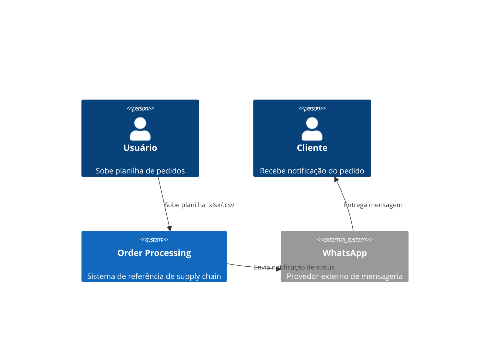
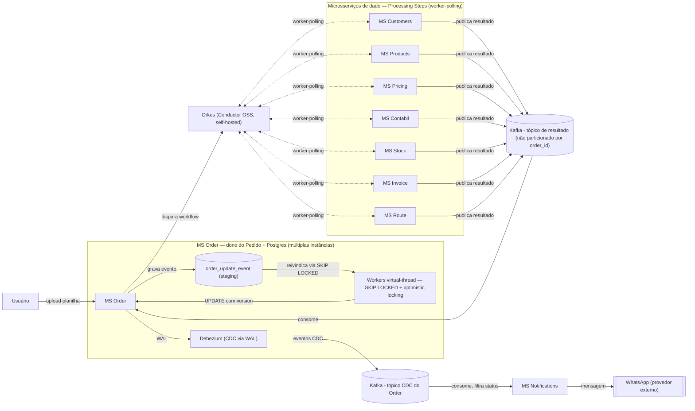
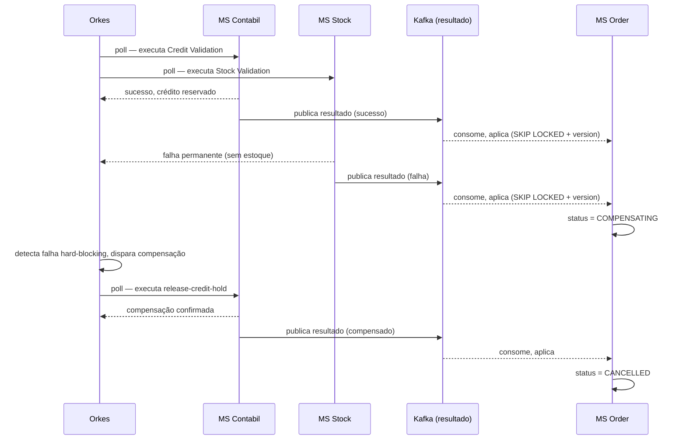

# PRD: Order Processing — sistema de referência (supply chain + guardrails de qualidade)

**Status:** Draft
**Author:** george@bonespirito.com (via Claude Code, sessão de grilling)
**Date:** 2026-08-27
**Version:** 1.0

---

## 1. Executive Summary

### Problem statement
- Faltava um projeto de referência real que provasse, em código, os guardrails de qualidade determinísticos discutidos em "Uncle Bob on Software Fundamentals in the Age of AI" (CRAP score/coverage+complexidade, mutation testing, architecture checker, MockK, Gherkin, QA E2E) — ver `doc/transcripts/ferramentas-qualidade-codigo.md`.
- Paralelamente, existia a necessidade de aprender/testar na prática: virtual threads (Java), concorrência de escrita no Postgres (`SKIP LOCKED` vs. optimistic locking — havia confusão real sobre qual resolve qual problema), CDC via Debezium, e Kafka. Hoje a concorrência de escrita em registros compartilhados é resolvida via lock distribuído no Redis.

### Proposed solution
- Um sistema de referência de supply chain — **Order Processing** — com 9 microsserviços orquestrados pelo Orkes (Conductor OSS, self-hosted), cada um demonstrando um guardrail e/ou um conceito de concorrência/streaming diferente, começando pelo MS Order (o mais crítico e mais desenhado até agora).
- Sucesso = cada MS implementado nasce com o pipeline de guardrails rodando (`./gradlew check` verde) e os cenários Gherkin do domínio passando; a concorrência real do Order (`SKIP LOCKED` + optimistic locking) é demonstrável e testável, sem depender de Redis.

### Scope
- **In scope:** MS Order (import em massa, Processing Steps, concorrência, CDC), MS Notifications (WhatsApp em mudança de status), design dos demais 7 MS de dado (Customers, Products, Pricing, Stock, Contabil, Invoice, Route) como dependências de API — implementação deles é incremental, fora deste PRD.
- **Out of scope (por ora):** implementação de código de qualquer serviço (esta rodada foi só design — ver Decisão de escopo abaixo); escolha de provedor real de WhatsApp; cálculo real de rota (MS Route é só contrato, sem lógica de roteirização definida); fórmula composta de CRAP score (fica JaCoCo+Detekt como proxy, ver `ferramentas-qualidade-codigo.md`).

---

## 2. Functional Requirements

| ID | Requirement | Priority | Acceptance Criteria |
|---|---|---|---|
| FR-01 | Usuário importa pedidos em massa via planilha (.xlsx/.csv) | P0 | Upload cria 1 Order por linha válida, status `PENDING`; linhas inválidas são reportadas sem bloquear as válidas — ver `bulk_import.feature` |
| FR-02 | Order passa por Processing Steps concorrentes (Enrichment, Credit Validation, Stock Validation, Route Calculation, Invoice Generation) sem lost update | P0 | Duas etapas concorrentes no mesmo Order preservam as duas escritas — ver `concurrent_processing_steps.feature`, ADR 0001 |
| FR-03 | Mudanças no Order são publicadas via CDC no Kafka | P0 | Debezium captura toda mudança em `orders` via WAL, publica no tópico Kafka — ADR 0002 |
| FR-04 | Cliente recebe WhatsApp a cada mudança de status do Order | P1 | Mudança de `status` dispara mensagem; mudança em outro campo não dispara — ver `status_change_notification.feature`, ADR notifications/0001 |
| FR-05 | Workflow de processamento é orquestrado pelo Orkes, self-hosted | P0 | Conductor OSS roda via `docker compose`, sem dependência de conta externa (Orkes Cloud) |
| FR-06 | Falha permanente numa Processing Step hard-blocking cancela o Order e compensa efeito colateral já aplicado | P0 | Stock Validation/Credit Validation já bem-sucedidas são revertidas na própria base do MS dono; Order vai a `CANCELLED` — ver `compensating_flow.feature`, ADR raiz 0002 |

**Priority legend:** P0 = MVP (must have), P1 = Next iteration (should have)

### User stories
```
Como usuário do sistema,
Quero importar vários pedidos de uma vez via planilha,
Para não cadastrar cada um manualmente.

Como sistema,
Quero aplicar o resultado de Processing Steps concorrentes sem perder escrita,
Para que o Order reflita corretamente o trabalho de todas as etapas.

Como cliente que fez um pedido,
Quero ser avisado via WhatsApp a cada mudança de status,
Para acompanhar o andamento sem consultar o sistema.

Como sistema,
Quero desfazer efeito colateral já aplicado quando uma etapa posterior falha,
Para não deixar estoque ou crédito reservados num pedido cancelado.
```

- US-01 → FR-01
- US-02 → FR-02, FR-03
- US-03 → FR-04
- US-04 → FR-06

---

## 3. Definitions of Ready (DoR)

| # | Criterion | Status |
|---|---|---|
| 1 | Acceptance criteria definidos (Gherkin) | ✅ `bulk_import.feature`, `concurrent_processing_steps.feature`, `status_change_notification.feature`, `compensating_flow.feature` |
| 2 | Dependências identificadas | ✅ Postgres, Kafka, Debezium, Orkes/Conductor OSS, provedor WhatsApp (não escolhido) |
| 3 | Abordagem técnica validada | ✅ via sessão de grilling — ADRs raiz 0001/0002, order 0001/0002/0003, notifications 0001 |
| 4 | Cabe na arquitetura atual | N/A — é greenfield, arquitetura sendo definida por este PRD |
| 5 | Expectativas de performance/segurança documentadas | ⚠️ Não aprofundado — projeto de aprendizado, não produção |

Requisito NÃO atende DoR: **implementação em si** — decisão explícita da sessão foi "só desenhar por enquanto" (ver Decisão de escopo). Este PRD é o artefato de saída; a implementação é uma iteração futura.

---

## 4. Engineering Vision

### System impact
- 9 bounded contexts novos, todos greenfield: **Order** (dono do Pedido+status), **Customers**, **Products**, **Pricing**, **Stock**, **Contabil**, **Invoice**, **Route**, **Notifications**.
- Database-per-service — nenhum MS compartilha tabela com outro (ver decisão na sessão de grilling).
- Integração externa: provedor de WhatsApp Business API (não escolhido ainda — Twilio, Meta Cloud API, etc. são candidatos).
- Fluxo de dado: entrada via planilha (MS Order) → saída via Kafka (CDC) → WhatsApp (MS Notifications).

### C4 — Level 1: System Context

Diagrama editável: [`app/docs/diagrams/c4-l1-system-context.drawio.svg`](../diagrams/c4-l1-system-context.drawio.svg). Tudo decidido nesta altitude — sem elemento indefinido.



### C4 — Level 2: Container

Diagrama editável: [`app/docs/diagrams/c4-l2-containers.drawio.svg`](../diagrams/c4-l2-containers.drawio.svg) — verde sólido = decidido, cinza pontilhado = indefinido. MS Order (com Postgres/staging/workers/Debezium), Orkes, Apicurio Registry e os tópicos Kafka estão decididos; os outros 7 MS de dado, o provedor de WhatsApp e o deploy K3s estão indefinidos (gray areas #5, #6, #9). No SVG, tópicos Kafka são desenhados como **cilindro horizontal** (fila/tópico) e Postgres/staging como **cilindro vertical** (banco/tabela) — distinção que o Mermaid abaixo não consegue expressar (não tem shape de cilindro horizontal nativo), então no bloco a seguir todos aparecem como `[(...)]`; o SVG é a fonte visual correta, este Mermaid é só estrutura:



### C4 — Level 3: Component (MS Order)

Diagrama editável: [`app/docs/diagrams/c4-l3-order-components.drawio.svg`](../diagrams/c4-l3-order-components.drawio.svg). Só MS Order tem L3 — é o único container com detalhe suficiente resolvido; os outros 8 MS ainda não têm nem `CONTEXT.md` (gray area #5), então um L3 deles seria invenção, não design. Consistente com `rules/docs.md`: "C4 Level 3 gerado sob demanda quando a complexidade justifica."

Decidido (verde): Bulk Import Handler, `Order`/`OrderItem` (JPA, aggregate root), Repository, os 7 consumers Kafka, `order_update_event` (staging), worker pool `SKIP LOCKED`, apply com optimistic locking, Debezium connector, DLT Publisher. Indefinido (cinza pontilhado): contrato REST do endpoint de import (path/shape — nunca especificado), contract test de schema Avro em CI (gray area #12), classificador transitória-vs-permanente (o conceito está na ADR raiz 0005, os tipos de exceção específicos não).

### Modelo de dados: `orders` e `order_items`

Order é aggregate root; `order_items` é tabela filha (N produtos por pedido — confirmado nesta rodada de grilling, substituindo a suposição inicial de item único). Um `version` só, no Order, protege o agregado inteiro incluindo os itens (ver nota de escopo na ADR order/0001). Snapshots (`customer_snapshot`, `product_snapshot`) são colunas tipadas/`@Embedded` (Value Objects), não JSONB — consistente com Tactical DDD.

**`orders`**

| Coluna | Origem | Nullable até a etapa rodar |
|---|---|---|
| `id` | import | — (PK, é o `orderId` do Kafka) |
| `status`, `version` | sistema | — |
| `customer_id` | import | — (referência opaca ao MS Customers, sem FK real — database-per-service) |
| `source_system_code` | import | — (qual sistema de origem mandou o pedido, ex: "SAP") |
| `source_order_number` | import | — (chave natural do pedido no sistema de origem; par com `source_system_code` deve ser `UNIQUE` — usado pra idempotência do import, ver Contrato REST) |
| `order_created_at` | import | — (data de criação no sistema de origem — distinto de `created_at`, que é quando ESTE sistema processou) |
| `customer_snapshot` (`@Embedded`: nome, documento, endereço de entrega) | Data Enrichment (Customers) | sim |
| `credit_status`, `credit_hold_id` | Credit Validation | sim |
| `stock_reservation_id` | Stock Validation | sim (atômico pro pedido inteiro — Stock Validation é hard-blocking, não há reserva parcial por item) |
| `route_id`, `tracking_code`, `estimated_delivery` | Route Calculation | sim |
| `invoice_number`, `invoice_issued_at` | Invoice Generation | sim |
| `import_batch_id` | import | — (rastreia a `bulk_import.feature` de origem) |
| `created_at`, `updated_at` | sistema | — |

**`order_items`**

| Coluna | Origem | Nullable até a etapa rodar |
|---|---|---|
| `id` | import | — (PK) |
| `order_id` | import | — (FK, não é aggregate próprio — ver termo Order Item no CONTEXT.md) |
| `sku`, `quantity` | import | — |
| `product_snapshot` (`@Embedded`: nome, categoria) | Data Enrichment (Products) | sim |
| `unit_price`, `currency` | Data Enrichment (Pricing) | sim |

**`import_batches`** (ADR order/0004 — existe antes de qualquer `Order`, por isso não é campo em `orders`)

| Coluna | Descrição |
|---|---|
| `id` | PK, é o `importBatchId` do contrato REST |
| `status` | `PENDING` \| `PROCESSING` \| `COMPLETED` \| `COMPLETED_WITH_ERRORS` |
| `total_rows`, `processed_rows`, `orders_created` | contadores, atualizados durante o processamento |
| `file_name` | rastreabilidade |
| `created_at`, `completed_at` | `completed_at` nullable até terminar |

**`import_batch_row_errors`**

| Coluna | Descrição |
|---|---|
| `id` | PK |
| `import_batch_id` | FK |
| `row_number` | linha da planilha onde o erro ocorreu |
| `reason` | motivo (dado ausente, duplicata de `source_order_number`, etc.) |

### Contrato REST: bulk import (ADR order/0004)

Planilha denormalizada: cabeçalho (`source_system_code`, `source_order_number`, `customer_code`, `order_created_at`) repetido em toda linha de item (`sku`, `quantity`). Até ~50.000 linhas por arquivo.

**`POST /imports/orders`** — multipart, campo `file` (.xlsx ou .csv)
→ `202 Accepted`
```json
{ "importBatchId": "uuid", "status": "PENDING" }
```

**`GET /imports/orders/{importBatchId}`**
→ `200 OK`
```json
{
  "importBatchId": "uuid",
  "status": "PENDING | PROCESSING | COMPLETED | COMPLETED_WITH_ERRORS",
  "totalRows": 50000,
  "processedRows": 50000,
  "ordersCreated": 12000,
  "rowErrorCount": 3
}
```
Erros de linha não vêm inline (lote ruim pode ter milhares) — ficam em `import_batch_row_errors`; endpoint de listagem paginada dos erros fica como detalhe de implementação, não desenhado nesta rodada.

Duplicata de `(source_system_code, source_order_number)` — dentro do mesmo lote ou contra lote anterior — vira `import_batch_row_errors`, não bloqueia o resto.

### Diagrama de sequência: fluxo compensatório

Order com Credit Validation já bem-sucedida (crédito reservado) e Stock Validation falhando permanentemente por falta de estoque:



### Glossário e decisões arquiteturais

- **Glossário do domínio Order:** [`app/order/CONTEXT.md`](../../order/CONTEXT.md)
- **Mapa de contextos (9 MS):** [`app/CONTEXT-MAP.md`](../../CONTEXT-MAP.md)
- **ADR raiz 0001** — worker-polling entre Orkes e os 7 MS de dado, em vez de HTTP push: [`app/docs/adr/0001-worker-polling-for-processing-steps.md`](../adr/0001-worker-polling-for-processing-steps.md)
- **ADR raiz 0002** — fluxo compensatório (Saga): quais steps compensam, ordem do workflow, estado `COMPENSATION_FAILED`: [`app/docs/adr/0002-compensating-flow-for-order-processing.md`](../adr/0002-compensating-flow-for-order-processing.md)
- **ADR raiz 0003** — Avro + Apicurio Registry para as mensagens Kafka (resultado das steps e CDC): [`app/docs/adr/0003-avro-schema-registry-for-kafka-messages.md`](../adr/0003-avro-schema-registry-for-kafka-messages.md)
- **ADR raiz 0004** — um tópico Kafka por task do Conductor (7, não 1), Data Enrichment é sub-workflow de 3 tasks: [`app/docs/adr/0004-one-kafka-topic-per-processing-step.md`](../adr/0004-one-kafka-topic-per-processing-step.md)
- **ADR raiz 0005** — dead letter topic por tópico de resultado, pra falha de consumo em MS Order (distinto do retry de task do Conductor): [`app/docs/adr/0005-dead-letter-topics-for-order-consumer-failures.md`](../adr/0005-dead-letter-topics-for-order-consumer-failures.md)
- **Integration Spec** — schema completo dos 7 tópicos de resultado, envelope, retry/idempotência: [`app/docs/specs/processing-steps-kafka-integration.md`](processing-steps-kafka-integration.md)
- **ADR 0001 (Order)** — optimistic locking (version) substitui Redis lock para concorrência entre Processing Steps: [`app/order/docs/adr/0001-optimistic-locking-for-order-writes.md`](../../order/docs/adr/0001-optimistic-locking-for-order-writes.md)
- **ADR 0002 (Order)** — Debezium (WAL) em vez de outbox pattern para CDC do Order: [`app/order/docs/adr/0002-debezium-for-order-cdc.md`](../../order/docs/adr/0002-debezium-for-order-cdc.md)
- **ADR 0003 (Order)** — Kafka (tópico não particionado por order_id) + staging + SKIP LOCKED para aplicar resultado das Processing Steps: [`app/order/docs/adr/0003-kafka-staging-skip-locked-for-processing-results.md`](../../order/docs/adr/0003-kafka-staging-skip-locked-for-processing-results.md)
- **ADR 0004 (Order)** — bulk import assíncrono (202 Accepted) com tabela própria de status do lote: [`app/order/docs/adr/0004-async-bulk-import-with-batch-status.md`](../../order/docs/adr/0004-async-bulk-import-with-batch-status.md)
- **ADR notifications/0001** — MS Notifications consome o tópico CDC existente em vez de evento de domínio próprio: [`app/notifications/docs/adr/0001-consume-order-cdc-topic.md`](../../notifications/docs/adr/0001-consume-order-cdc-topic.md)

### Onde entram os conceitos que motivaram o projeto

| Conceito a aprender/testar | Onde vive no design |
|---|---|
| Virtual threads | Ingestão em massa da planilha (MS Order); pool de workers que reivindicam `order_update_event` |
| `SKIP LOCKED` | Fila interna `order_update_event` em MS Order — workers reivindicam evento pendente, não o Order em si (ADR 0001 explica por que `SKIP LOCKED` não serve pra proteger a linha do Order diretamente; ADR 0003 explica onde ele reaparece) |
| Concorrência entre instâncias | Tópico Kafka de resultado, deliberadamente não particionado por `order_id` — sem isso, o Kafka serializaria por Order e a race que o optimistic locking precisa resolver nunca aconteceria (ADR 0003) |
| Optimistic locking | Coluna `version` no Order — mecanismo real que evita lost update entre Processing Steps concorrentes |
| CDC / Debezium | MS Order publica toda mudança da tabela `orders` via WAL (ADR 0002) |
| Kafka | Dois tópicos distintos: resultado das Processing Steps (MS→Order, ADR 0003) e CDC do Order (Order→Notifications/externos, ADR 0002) |

### Guardrails de qualidade (objetivo original do projeto)

Aplicados a cada MS conforme for implementado, começando por MS Order — mapeamento ferramenta do vídeo → ferramenta Kotlin/Gradle já validado antes desta sessão de grilling:

| Ferramenta do vídeo | Implementação | Gate |
|---|---|---|
| CRAP score (proxy) | JaCoCo (coverage) + Detekt (complexidade, threshold humano=8/agente=12) | `./gradlew check` |
| Mutation testing | Pitest, `targetClasses=domain.*` | `./gradlew pitest` (separado, mais caro) |
| Architecture checker | ArchUnit — camadas controller/application/domain/infra | `./gradlew check` |
| MockK | Testes de `application`, substitui Mockito | `./gradlew check` |
| Gherkin | Cucumber-JVM — `bulk_import.feature`, `concurrent_processing_steps.feature`, `status_change_notification.feature`, `compensating_flow.feature` | `./gradlew check` |
| QA procedure / E2E | Playwright contra HTTP real | `docker compose run --rm e2e pnpm test:e2e` (separado) |

### Key technical constraints
- Container-first obrigatório (golden rule) — todo MS com `Dockerfile` + serviço na `compose.yaml`, nada roda no host.
- Kotlin + Spring Boot, Gradle Kotlin DSL + version catalog — sem exceção, por MS.
- Performance/disponibilidade/segurança: **não aprofundado** — projeto de aprendizado, não é para produção real; se algum dia for, revisitar antes.

### Risks & unknowns

| Risk | Impact | Mitigation |
|---|---|---|
| Pitest não tem plugin Kotlin-aware maduro/gratuito | Mutantes ruidosos em `data class`/`when` exaustivo | Restringir `targetClasses` a `domain.*`, documentar falso-positivo conhecido |
| Provedor de WhatsApp não escolhido | Bloqueia implementação de MS Notifications até decidir | Definir na iteração que for implementar Notifications, não bloqueia o design dos outros MS |
| Escala do "import em massa" não quantificada | Design de parsing (streaming vs. DOM completo do .xlsx) pode ficar errado se volume for muito maior que o assumido | Perguntar volume esperado antes de detalhar o parser, quando chegar a hora de implementar |
| 9 MS é escopo grande pra uma pessoa manter | Risco de abandono/inconsistência entre serviços | Implementação incremental por fatia vertical (MS Order primeiro), não big-bang — decisão já tomada nesta sessão |
| Database-per-service + Debezium por serviço = 9x a infra de CDC se todos publicarem CDC | Complexidade operacional alta | Só MS Order tem CDC/Debezium confirmado neste PRD; os demais MS decidem sob demanda quando forem implementados |
| `COMPENSATION_FAILED` não tem caminho de resolução automatizado | Order fica travado exigindo intervenção manual, sem ferramenta de ops desenhada para isso | Fora de escopo deste projeto de aprendizado; se algum dia for produção real, desenhar um painel/processo de retomada manual antes |
| Compensação assume que a ação compensatória é idempotente e nunca falha parcialmente | Se MS Stock/Contabil aplicar a compensação de forma não-idempotente, retry pode duplicar o efeito (ex: devolver estoque duas vezes) | Cada MS compensatório precisa desenhar sua ação de compensação como idempotente — checar antes de implementar Stock/Contabil |

---

## 5. Test Scenarios

Cenários Gherkin já escritos como `.feature` executável (não só tabela ilustrativa — ver nota sobre gap no `FEATURE_SPEC.md` abaixo):

| ID | Scenario | Given | When | Then | Mapped FR | Arquivo |
|---|---|---|---|---|---|---|
| TC-01 | Upload aceito, processa em background | Planilha .csv válida, 3 pedidos | `POST /imports/orders` | `202 Accepted` com `importBatchId`, status `PENDING` | FR-01 | `app/order/.../bulk_import.feature` |
| TC-01b | Status reflete resultado | `importBatchId` já processado | `GET /imports/orders/{id}` | status `COMPLETED`, `ordersCreated=3`, workflow disparado por Order | FR-01 | `app/order/.../bulk_import.feature` |
| TC-02 | Import com linha inválida | Planilha com 1 linha sem cliente | Upload + aguarda processar | status final `COMPLETED_WITH_ERRORS`, `ordersCreated=2`, erro em `import_batch_row_errors` | FR-01 | `app/order/.../bulk_import.feature` |
| TC-02b | Pedido duplicado | Order já importado com mesmo `source_system_code`+`source_order_number` | Nova planilha repete essa chave | Linha vira erro de duplicata; nenhum Order novo criado | FR-01 | `app/order/.../bulk_import.feature` |
| TC-03 | Concorrência sem lost update | Order v1, 2 etapas concorrentes | Enrichment + Credit Validation reportam ao mesmo tempo | Ambas as escritas preservadas, versão avança em 2 | FR-02 | `app/order/.../concurrent_processing_steps.feature` |
| TC-04 | Conflito de versão | Order v3, 2 escritas concorrentes na mesma versão | Escritas simultâneas | Uma aplica e avança pra v4; outra recarrega v4 e reaplica | FR-02 | `app/order/.../concurrent_processing_steps.feature` |
| TC-05 | Notificação em mudança de status | Order `PENDING`, cliente com WhatsApp | Status muda pra `PROCESSING` | Evento CDC publicado; WhatsApp enviado | FR-03, FR-04 | `app/notifications/.../status_change_notification.feature` |
| TC-06 | Sem notificação fora de status | Order `PROCESSING` | Campo não-status muda | Nenhuma mensagem enviada | FR-04 | `app/notifications/.../status_change_notification.feature` |
| TC-07 | Compensação após falha posterior | Credit Validation já sucedida (crédito reservado); Stock Validation falha permanentemente | Falha detectada pelo Orkes | Order vai a `COMPENSATING`; MS Contabil recebe ação de liberar crédito; Order vai a `CANCELLED` | FR-06 | `app/order/.../compensating_flow.feature` |
| TC-08 | Falha sem efeito colateral pendente | Nenhuma etapa compensatória com sucesso ainda | Data Enrichment falha permanentemente | Order vai direto a `CANCELLED`, sem `COMPENSATING`, sem ação compensatória | FR-06 | `app/order/.../compensating_flow.feature` |
| TC-09 | Compensação que falha | Order `COMPENSATING`, Stock Validation pendente de compensação | Ação compensatória de estoque falha após esgotar tentativas | Order vai a `COMPENSATION_FAILED`, sem retry automático adicional | FR-06 | `app/order/.../compensating_flow.feature` |
| TC-10 | Invoice só após as 4 hard-blocking | Enrichment, Credit Validation, Stock Validation e Route Calculation concluídas com sucesso | Orkes avalia o workflow | Invoice Generation é disparada; Order vai a `INVOICING` | FR-02, FR-06 | `app/order/.../compensating_flow.feature` |

**Gap identificado nesta sessão:** `~/.claude/templates/FEATURE_SPEC.md` não tem elo pra traduzir a tabela Given/When/Then do PRD em `.feature` executável — esses arquivos foram criados diretamente para este projeto, fora do fluxo padrão de templates.

---

## 6. Rollout & Success

### Definition of Done (DoD) — por MS implementado
- [ ] `./gradlew check` verde (compile + testes + ArchUnit + Cucumber + Detekt + JaCoCo)
- [ ] `./gradlew integrationTest` verde (quando aplicável — repositório real)
- [ ] `./gradlew pitest` rodado, mutation score revisado (não necessariamente 100%, mas sem mutante óbvio ignorado)
- [ ] `docker compose run --rm e2e pnpm test:e2e` verde
- [ ] ADRs relevantes escritos/atualizados
- [ ] `CONTEXT.md` do contexto atualizado se linguagem nova surgiu

### Success metrics
Projeto de aprendizado — sucesso é qualitativo, não métrica de produto:
- Você consegue explicar, com o código rodando, por que `SKIP LOCKED` não resolve lost update no Order e o que resolve.
- Virtual threads demonstráveis com throughput comparável (mesmo que informalmente) contra thread pool tradicional na ingestão em massa.
- CDC via Debezium funcionando ponta a ponta, evento chegando em MS Notifications e disparando WhatsApp.

### Rollout plan
- Sem rollout de produção — decisão desta sessão foi manter em design até você decidir implementar.
- Quando for implementar: começar por **MS Order** sozinho (fatia vertical), guardrails completos nele primeiro, antes de tocar nos outros 8 MS.

### Direção futura: deploy on-premise (K3s) — ainda não decidido, só registrado

Existe um servidor on-premise (Ubuntu Server) disponível como alvo de deploy real, pra validar fluxo de deploy e autoscaling — algo que não é possível de forma nativa só com `docker compose` local (sem HPA-equivalente; só `--scale` manual).

- **Orquestrador escolhido: K3s** (não Docker Swarm) — decisão já tomada, mesmo que a execução fique pra depois. Motivo: só K3s (K8s completo, porém leve) habilita **KEDA** de verdade reagindo a lag de consumer group Kafka — Swarm exigiria `docker-flow-monitor` + Prometheus, caminho menos direto e menos documentado hoje.
- **Brokers de apoio (Postgres, Kafka, Orkes) provisionados direto no K3s desde o início da implementação** — evita montar um setup descartável via `docker compose` local e depois refazer tudo pra migrar pro cluster. Quando a implementação começar, a primeira peça de infra é o K3s + esses 3 brokers rodando lá, não um `compose.yaml` local que depois vira obsoleto.
- **Em aberto, não resolvido:** o loop de desenvolvimento do dia a dia (edição de código, `./gradlew check` rápido) continua local via `docker compose` (container-first, mas sem depender do cluster pra iterar) enquanto o K3s fica reservado pra validar deploy/autoscaling? Ou o dev loop também passa a mirar o K3s desde o início, sem `compose.yaml` nenhum? Isso muda o `Dockerfile`/manifests que precisam existir e não foi decidido — fica pra quando este direcionamento for puxado de verdade (grilling dedicado, como fizemos pro domínio).
- **Também em aberto:** secrets (senha do Postgres, credencial do WhatsApp, config do Orkes), exposição de rede (se o provedor de WhatsApp exigir webhook público, o servidor on-prem só em LAN não resolve sozinho), e caminho de CI/CD do Codeberg (Forgejo Actions, não GitHub Actions — o `CLAUDE.md` global cita GitHub Actions, mas o repo deste projeto está no Codeberg) até o K3s.

---

## 7. Partes cinzentas (tracking — não perder de vista)

Lista viva, atualizada a cada rodada de grilling. Status: ✅ resolvido, 🟡 parcial, ⬜ aberto.

**Bloqueantes pra implementar MS Order:**
1. ✅ Schema das mensagens Kafka — Avro + Apicurio Registry, 7 tópicos (1 por task do Conductor), envelope comum definido — ADR raiz 0003/0004, `processing-steps-kafka-integration.md`.
2. ✅ Colunas reais de `orders` e `order_items` (tabela filha, N itens por pedido) — seção "Modelo de dados" acima; snapshots como `@Embedded`, não JSONB; `version` único cobre o agregado inteiro (nota de escopo na ADR order/0001).
3. ✅ Retry/timeout do worker-polling — 3 tentativas, backoff exponencial (1s/5s/15s) — `processing-steps-kafka-integration.md`, seção Resilience.
4. ✅ Idempotência da ação compensatória — `resultId` (aplicação ao Order) + `creditHoldId`/`stockReservationId` (compensação em si) — mesma seção.

**Bloqueantes pros outros 8 MS:**
5. ⬜ Nenhum MS além de Order tem `CONTEXT.md` — linguagem de domínio de Customers, Products, Pricing, Stock, Contabil, Invoice, Route, Notifications não resolvida.

**Em aberto, não bloqueante agora:**
6. ⬜ Provedor de WhatsApp (Twilio/Meta Cloud API/outro).
7. ✅ Volume: até ~50.000 linhas/arquivo, planilha denormalizada (cabeçalho repetido por item) — ADR order/0004.
8. ⬜ `COMPENSATION_FAILED` sem caminho de resolução automatizado (aceito como fora de escopo).
9. ⬜ Direção K3s — dev loop local vs. cluster, secrets, exposição de rede, CI/CD Codeberg→K3s (seção 6 acima).
10. ⬜ Teste de integração da Saga ponta a ponta (além do Gherkin de aceitação) — não desenhado.
11. ✅ Dead letter — tópico `.dlt` por tópico de resultado, retry curto pra falha transitória, direto ao DLT pra falha permanente, resolução manual — ADR raiz 0005.
12. ⬜ Mecanismo de contract test do schema Avro em CI (compatibility check antes de publish) — não desenhado.
13. ✅ Contrato REST do bulk import — `POST /imports/orders` (202) + `GET /imports/orders/{id}` (status/polling) — ADR order/0004, seção "Contrato REST".
14. ⬜ Classificador de exceção transitória vs. permanente pro DLT (ADR raiz 0005 define o conceito, não os tipos concretos de exceção) — também surgiu no C4 L3.

---

## Roadmap visual

Evolução da série de sessões de grilling, fase a fase, com o que já foi decidido/registrado vs. direção futura vs. em aberto: [`app/docs/diagrams/project-roadmap.drawio.svg`](../diagrams/project-roadmap.drawio.svg) (editável no draw.io).

## Histórico da sessão (rastreabilidade)

- Repositório inicializado em Codeberg (`torgge/uncle-bob-best-practices-with-ia`) via `tea` CLI, commit inicial com o conteúdo de `doc/transcripts/`.
- Domínio evoluiu de um "Task Manager" genérico (descartado) para este sistema de Order Processing, através de uma sessão de grilling completa (`/mattpocock-skills:grill-with-docs`) que corrigiu, entre outras coisas, o mal-entendido inicial sobre `SKIP LOCKED` vs. optimistic locking.
- Escopo de implementação foi explicitamente limitado a design nesta rodada — nenhum código Kotlin/Gradle foi criado, só documentação/especificação (ADRs, CONTEXT.md, Gherkin, diagrama).
